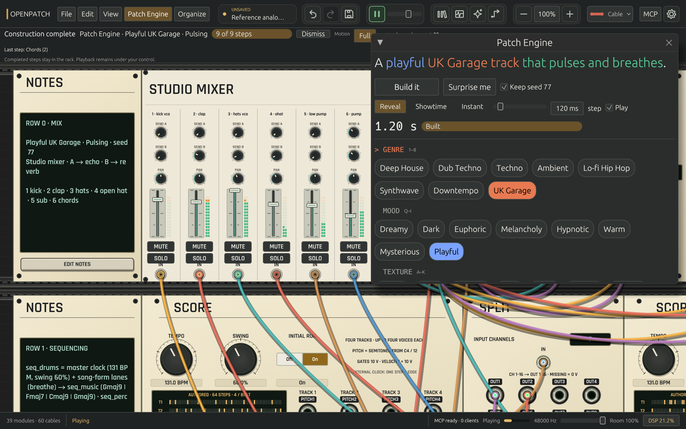

<p align="center">
  
</p>

<p align="center">
  An open-source modular synthesizer built in Rust.<br>
  Make music by connecting modules, or build a patch with help from Claude or Codex.
</p>

<p align="center">
  <a href="#download">Download</a> ·
  <a href="#get-started">Get started</a> ·
  <a href="#use-claude-or-codex">Claude &amp; Codex</a> ·
  <a href="docs/ROADMAP.md">Roadmap</a>
</p>



## Download

**OpenPatch 0.3.1 · build 11**

| Your computer | Download |
|---|---|
| Mac with Apple silicon · macOS 12 or later | [Download for Mac](https://github.com/dexterlabs1/openpatch/releases/download/v0.3.1/OpenPatch-macos-arm64.zip) |
| Windows PC · 64-bit Intel or AMD | [Download for Windows](https://github.com/dexterlabs1/openpatch/releases/download/v0.3.1/OpenPatch-windows-x86_64.zip) |
| Steam Deck or Linux PC · 64-bit Intel or AMD | [Download for Steam Deck / Linux](https://github.com/dexterlabs1/openpatch/releases/download/v0.3.1/OpenPatch-linux-x86_64.tar.gz) |

Extract the download, then:

- **Mac:** move `OpenPatch.app` to Applications and open it.
- **Windows:** open `openpatch-desktop.exe`. Keep the extracted files together.
- **Linux / Steam Deck:** run `./install.sh` from the extracted folder, then open OpenPatch from your application menu. On Deck, install in Desktop Mode; the included `STEAM-DECK.txt` explains controller setup.

The Mac app is not notarized by Apple. The Windows app is unsigned.

[Release notes and checksums](https://github.com/dexterlabs1/openpatch/releases/tag/v0.3.1)

## Get started

1. Open OpenPatch and press **F1** to open the **Patch Engine**.
2. Pick a genre, mood and texture, then choose **Build**. Try **Surprise me** for a random combination.
3. Turn knobs, drag cables between ports, and add modules to change the sound.
4. Save your patch with **Cmd-S** on Mac or **Ctrl-S** on Windows/Linux.

Keep a patch's seed to generate the same composition again. Choose **Reveal**, **Showtime** or **Instant** to change how quickly it appears in the rack.

To build from scratch, close the Patch Engine and press **Enter** to open the module library. **Space** starts or pauses playback when the Patch Engine is closed.

## What you can do

- **Make music:** combine oscillators, filters, envelopes, sequencers, drums and effects. Studio Mixer has up to 16 channels and two effects send/return loops.
- **Explore new instruments:** Tidal Functions, Frame Scene, Segment Garden, Event Fork, Rhythm Terrain and Recall Random add evolving modulation, scene mixing, envelopes, random gates, drum patterns and repeating pitch phrases. [Module guide](docs/MODULE_COVERAGE.md)
- **Keep a patch readable:** organize modules into rows, highlight signal paths, change cable styles, and dim the room to see the lights.
- **Make visuals:** choose from nine visualizers, including Ferrofluid, or edit GLSL shaders in the app. [Visualizer guide](docs/VISUALIZERS.md)
- **Work with an assistant:** watch Claude or Codex add modules, connect cables and adjust values in the rack. You can undo those edits just like your own.

[Controls and shortcuts](docs/RACK_EDITING.md) · [Saving and recovery](docs/PROJECTS.md) · [Example patches](examples)

## Use Claude or Codex

Open the **MCP** panel in OpenPatch and follow the [setup guide](docs/MCP.md). MCP lets an assistant inspect your patch, add modules, connect cables, change settings, save and render audio.

Connecting to an already open window works on Mac and Linux. On Windows, start a session with `openpatch-desktop.exe --mcp`.

## Still in development

OpenPatch is an early release. It does not yet match all of VCV Rack's features or module library.

You can [import supported VCV patches](docs/VCV_IMPORT.md), but not every module can be converted. Existing VCV plugins do not load automatically. An experimental Mac host supports one pinned Bogaudio OFFSET build with separate setup. [Experimental hosting guide](docs/BINARY_HOST_V1.md) Development source also supports the pinned XFADE profile. [Development profiles](docs/BINARY_HOST_PROFILES.md)

Windows audio devices and Steam Deck game mode still need hands-on testing.

[Roadmap](docs/ROADMAP.md) · [Current work](docs/WORKPLAN.md) · [Report a problem](https://github.com/dexterlabs1/openpatch/issues)

## Build from source

Install stable Rust and your platform's build tools. On Mac, install Xcode Command Line Tools. Linux dependencies are listed in the [build workflow](.github/workflows/ci.yml).

```sh
git clone https://github.com/dexterlabs1/openpatch.git
cd openpatch
git checkout v0.3.1
cargo build --locked --release -p openpatch-desktop -p openpatch --bins
cargo run --locked --release -p openpatch-desktop
```

The app and command-line tool are in `target/release`. To package the Mac app, run `python3 scripts/package_macos.py` with Python 3.11 or later.

## License

Original OpenPatch code is [MIT licensed](LICENSE). The distributed app also includes GPL code and is provided under [GPL-3.0-or-later](crates/openpatch-core/LICENSE-GPL-3.0.txt). See the [third-party notices](crates/openpatch-core/LICENSE-THIRD-PARTY) for details.

OpenPatch is an independent project and is not affiliated with VCV. [Release source code](https://github.com/dexterlabs1/openpatch/tree/v0.3.1)
