<p align="center">
  
</p>

<p align="center">
  A native modular synthesizer in Rust.<br>
  Build a voice, follow the voltage, and make it move.
</p>

<p align="center">
  <a href="https://github.com/dexterlabs1/openpatch/actions/workflows/ci.yml"></a>
  <a href="LICENSE"></a>
  <a href="Cargo.toml"></a>
</p>

<p align="center">
  <a href="#get-started-on-macos">Get started</a> ·
  <a href="#play-the-rack">Controls</a> ·
  <a href="docs/MCP.md">Claude &amp; Codex</a> ·
  <a href="#where-it-stands">Project status</a> ·
  <a href="#go-deeper">Documentation</a>
</p>

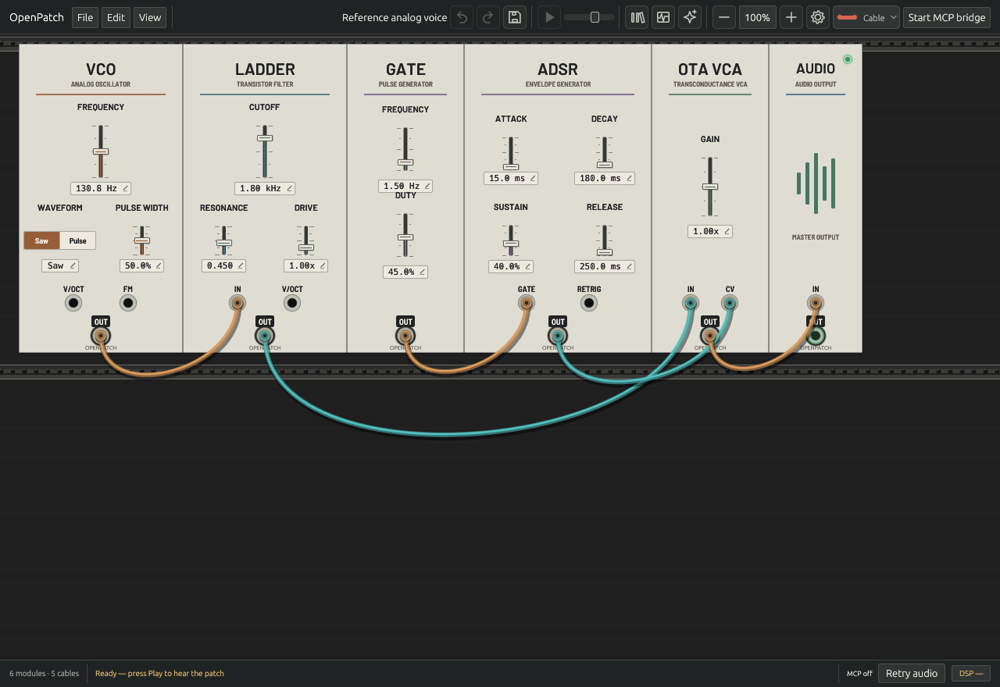
<p align="center"><sub>Studio Rack panels, transport toolbar and analysis dock in the native desktop app, rendered on Linux with Mesa in CI. macOS is the primary design target.</sub></p>

- **An instrument you can patch.** Turn rotary controls, connect cables, and arrange modules on rack rails. Live edits preserve oscillator phase and circuit memory.
- **A reference analog voice.** Explore a nonlinear transistor ladder, OTA VCA, and switched RC envelope alongside an idealized ramp VCO, gate clock, and voltage/audio interface. Each model has [documented assumptions and validation](docs/ANALOG_MODELS.md).
- **Build a richer voice.** Blend four simultaneous oscillator waveforms, drive FM and PWM, and choose hard or soft sync. [Audio oscillator and validation →](docs/AUDIO_OSCILLATOR.md)
- **Write a moving pattern.** Sequence pitch, timbre, and accents with three rows of eight voltage controls, live step lights, and Clock/Run/Reset actions. [Sequencer controls →](docs/SEQUENCER.md)
- **Build longer arrangements.** Use SCORE through MCP for chords, ratchets and automation, then shape the mix with native drums, stereo delay, reverb and sidechain compression. [Scores and studio modules →](docs/SCORE_AND_STUDIO.md)
- **Shape and route control signals.** Eight attenuverters, ten independent mutes, and a three-input CV mixer add voltage offsets and performance control. Module bypass is saved and undoable. [Voltage utilities →](docs/VOLTAGE_UTILITIES.md)
- **Follow the voltage.** Probe any output and voice in the native signal scope. Compare two signals, trigger a waveform, or switch to X/Y; read calibrated range, DC, and RMS. [Scope controls →](docs/SCOPE.md)
- **Sound into motion.** Open the optional Aurora, Spectrum, or Waveform view in the analysis dock. Edit GLSL shaders in the app while the last working shader keeps running.
- **A rack agents can work with.** Claude and Codex can inspect, preview batch edits, patch, undo/redo, analyze individual output channels, capture waveform bins, tune, save, and render through a local MCP server using the same validated controls as the UI.

## Get started on macOS

For Apple Silicon, install stable [Rust](https://rustup.rs), Xcode Command Line Tools (`xcode-select --install`), and Python 3. Build a native application bundle:

```sh
git clone https://github.com/dexterlabs1/openpatch.git
cd openpatch
cargo build --locked --release -p openpatch-desktop
python3 scripts/package_macos.py
open dist/OpenPatch.app
```

The app opens a connected reference voice with playback paused. Press **Play** or **Space** to hear it. To run directly from source, use `cargo run --locked --release -p openpatch-desktop`.

This is a **v0.2 development preview**, built from source. The local `.app` is ad-hoc signed; it is not notarized. CI also builds Linux and Windows targets; platform notes are below.

## Play the rack

| Action | Control |
|---|---|
| Play / pause | **Space** or the transport toolbar button |
| Open the library | **Enter**, the library toolbar icon, **Edit → Add module**, or right-click empty rack space |
| Add from the library | Drag a tile onto the rack, click a tile, or use **Up/Down → Enter** in search |
| Patch / unplug | Drag or click between jacks; an occupied output picks its top plug for moving to another output; right-click an input to unplug |
| Add / clone a cable | **Cmd-drag** either jack adds a cable; **Cmd-Shift-drag** clones its top cable |
| Stack / remove cables | Drop onto a version-2 input to add a signal; **Shift-click** a jack deletes its top cable |
| Bring a buried plug forward | Right-click its jack → select the cable → **Move this cable**, then return it to the same jack; the opposite end keeps its order |
| Edit cable bundles / colours | Right-click either jack → **Move all cables**, individual cable actions, or **Custom RGB…**; each operation is undoable |
| Adjust a control | Drag vertically; hold **Cmd** for fine adjustment; double-click to reset |
| Type a value or expression | Right-click a knob, or double-click its displayed value; try `A4`, `440*2`, or `C4v`. **Enter** applies and **Esc** cancels |
| Blend and synchronize audio waveforms | **File → Synced waveform voice** |
| Layer voices with CV-controlled mixing | **File → Layered stereo morph** |
| Add transpose and vibrato to a chord | **File → Stacked pitch voice** |
| Shape gates and sample pitch | **File → Gate shaping voice** |
| Explore voltage and mute banks | **File → Voltage utilities** |
| Play manual gates and triggers | **File → Manual pulses voice** |
| Latch and interrupt a note | **File → Manual push voice** |
| Delay and reshape gates | **File → Delayed gate voice** |
| Bypass a module | Right-click its panel → **Bypass module** |
| Clock a stereo routing pattern | **File → Switched stereo voice** |
| Play the sequencer example | **File → Sequenced analog voice** |
| Inspect audio processing load | **View → Audio performance**, or click **DSP** in the footer; [measurement details](docs/PERFORMANCE.md) |
| Inspect a signal | **View → Signal scope**, the scope toolbar icon, or right-click an output jack → **Inspect in scope X/Y** |
| Select / arrange | **Shift-click** module headers to build a group; drag a selected header to move it; **Cmd-A** selects all |
| Duplicate | **Cmd-D** for modules only; **Shift-Cmd-D** adds inputs for a selection, or all cables for a hovered module when nothing is selected |
| Save / browse module presets | Right-click a module → **Presets**; preview settings before applying |
| Initialize / randomize | **Cmd-I** / **Cmd-R**, or the module context menu; one undo step per group |
| Remove | **Delete / Backspace** the selection, or the hovered module when nothing is selected |
| Clear patching | **Edit → Clear cables** removes all cables in one undoable action |
| Pan / zoom | Scroll, middle-drag, or arrow keys; pinch or **Cmd-scroll** to zoom **25–400%**; **Cmd −/+** steps zoom; **Cmd-0** restores 100% |
| Lock placement | **View → Lock module positions** prevents accidental module moves while keeping knobs and cables editable |
| Save / Save As / open | **Cmd-S** / **Shift-Cmd-S** / **Cmd-O** |
| Undo / redo | **Cmd-Z** / **Shift-Cmd-Z** |

Compatible jacks glow and snap during patching. Valid drops onto occupied version-2 inputs preserve existing cables. Dropping a moved plug on empty space, a wrong-type jack, or an identical route deletes that cable; **Esc** cancels. Add **Shift at drop** to permit an identical route. [Cable gestures →](docs/RACK_EDITING.md#cable-gestures) The quantizer’s piano keys toggle scale notes. One knob drag or completed single/group module move is one undo step. Module drag previews stay out of saves and recovery. Split and Merge expose all 16 ports; right-click a module to select its monitored output, or right-click an output jack to inspect its voltage in the signal scope. Polyphonic playback uses the first channel unless you route through SUM.

Use **Ctrl** in place of Cmd on Linux and Windows. Keyboard shortcuts apply outside text fields. **Esc** cancels patching or closes an editor.

Projects live in `~/OpenPatch` by default. **Save** updates the current `.openpatch` file with its modules, cables, layout, view, and current sequencer Run and Push HOLD settings; **Save As** creates another copy. Older JSON patches still import. Recovery copies keep unsaved work separate from the original and are offered on the next launch. [Saving and recovery →](docs/PROJECTS.md)

<details>
<summary><strong>See the visualizer dock</strong></summary>

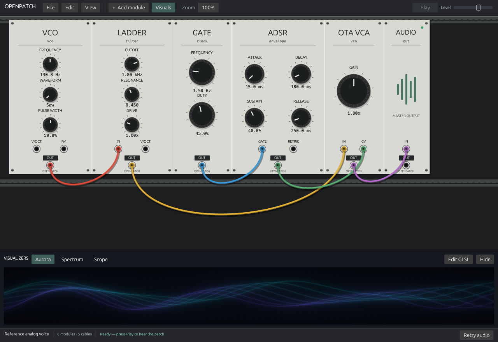

<sub>Linux / Mesa CI render. The dock uses native OpenGL; it requires a compatible GPU and driver.</sub>

[Visualizer modes and shader interface →](docs/VISUALIZERS.md)

</details>

<details>
<summary><strong>Inspect voltage, timing, and phase</strong></summary>

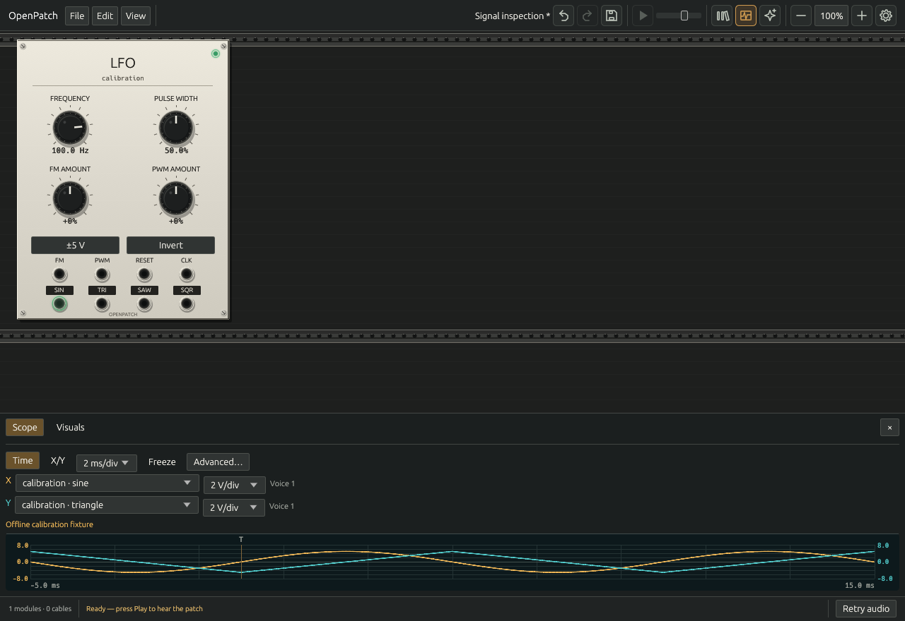

Right-click an output jack and choose **Inspect in scope X/Y**. Select a voice,
set the trigger and timebase, or freeze a capture to examine it. The scope reads
raw module outputs before master level. Claude and Codex can request calibrated
waveform bins with `capture_signal`, rendered offline from a patch snapshot.

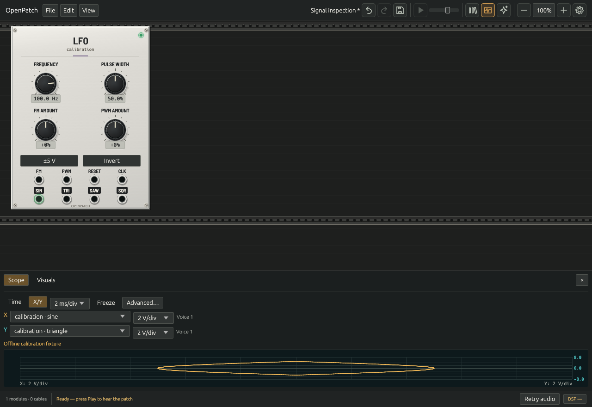

<sub>Native Linux / Mesa CI renders using an offline engine calibration fixture;
these images do not demonstrate live audio-device qualification.</sub>

[Scope controls, sampling contract, and remaining parity →](docs/SCOPE.md)

</details>

<details>
<summary><strong>Sequence pitch, timbre, and accents</strong></summary>

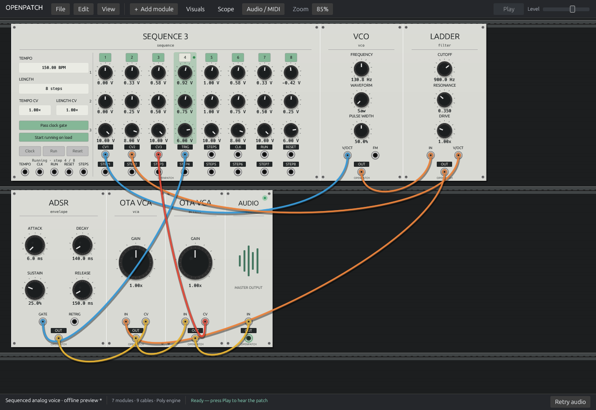

Choose **File → Sequenced analog voice**. Edit three independent voltage rows,
click step numbers to enable triggers, and rotate the pattern from the module's
context menu. Clock, Run, and Reset buttons use the same ordered performance
path available to Claude and Codex. Offline MCP events let you render or measure
a performance at specified sample frames.

<sub>Native Linux / Mesa CI render. The illuminated step comes from an offline
engine fixture; this screenshot does not demonstrate live audio-device testing.</sub>

[Sequencer controls, timing, and remaining parity →](docs/SEQUENCER.md)

</details>

<details>
<summary><strong>Arrange patterns and stereo effects</strong></summary>

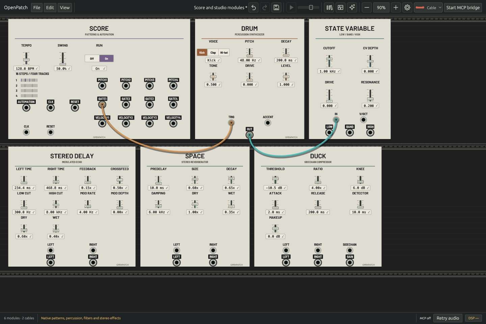

SCORE stores four note tracks and up to sixteen automation lanes. Use MCP to
edit scores, connect voices and export an arrangement of up to five minutes.
The panel exposes tempo, swing, run state and track outputs; a graphical note
editor remains future work.

These are original functional algorithms. Their documented limits include
SVF drive aliasing and differences from third-party VCV plugins.
[Module behavior, MCP examples and fidelity limits →](docs/SCORE_AND_STUDIO.md)

<sub>Native Linux / Mesa CI render. This fixture illustrates the panels and
connections; it does not demonstrate macOS device playback.</sub>

</details>

<details>
<summary><strong>Route a voice around the rack</strong></summary>

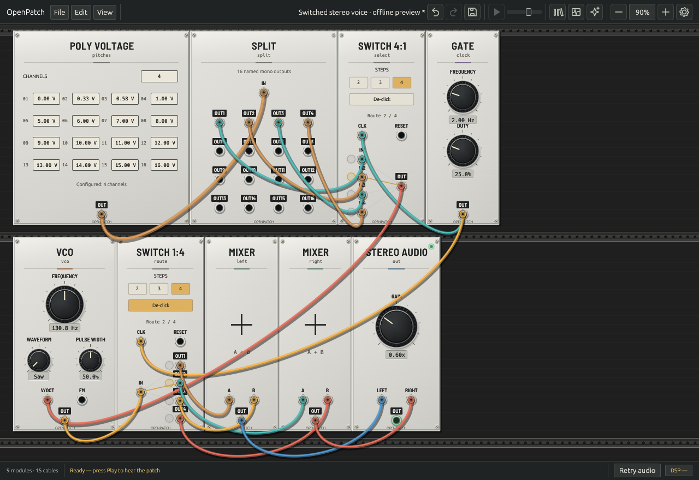

Choose **File → Switched stereo voice**. One switch selects among four pitches;
another routes the oscillator between left and right. Change either step count
to reshape the pattern, and enable de-click for short ramps between audio routes.
The illuminated route comes from the engine rather than a UI timer.

<sub>Native Linux / Mesa CI render with offline engine telemetry. Actual device
playback qualification remains separate.</sub>

[Clocked routing and polyphony →](docs/SWITCHING.md)

</details>

<details>
<summary><strong>Blend voices with voltage-controlled mixing</strong></summary>

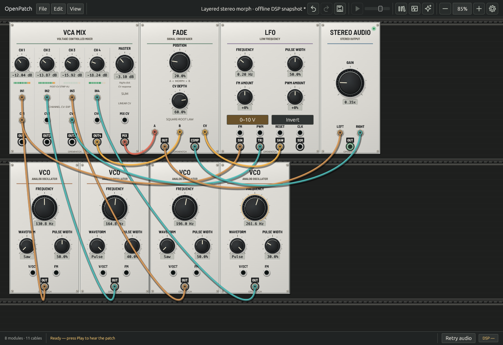

Choose **File → Layered stereo morph**. Mix four voices with independent level
and CV controls, watch each channel's meter, and use Fade's complementary
outputs to move the blend across stereo. Both modules support polyphonic signals.

<sub>Native Linux / Mesa CI render with offline engine meter data.</sub>

[Mixing controls, response curves, and channel behavior →](docs/VOLTAGE_MIXING.md)

</details>

<details>
<summary><strong>Shape voltages and mute a voice</strong></summary>

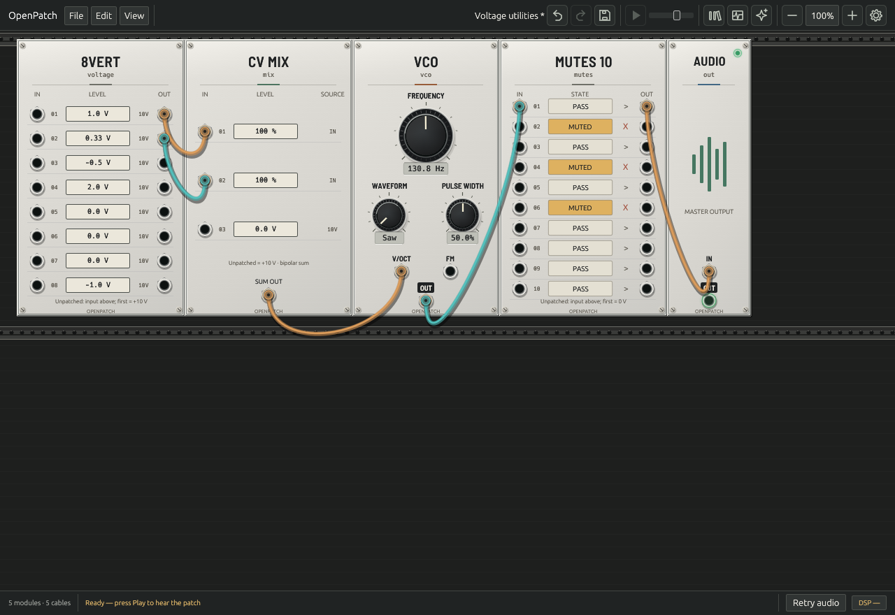

Choose **File → Voltage utilities**. The first two 8vert rows create pitch
voltages, CV Mix adds them, and Mutes row 1 controls the oscillator's output.
Each row is independently editable; right-click Mutes to invert all ten states.

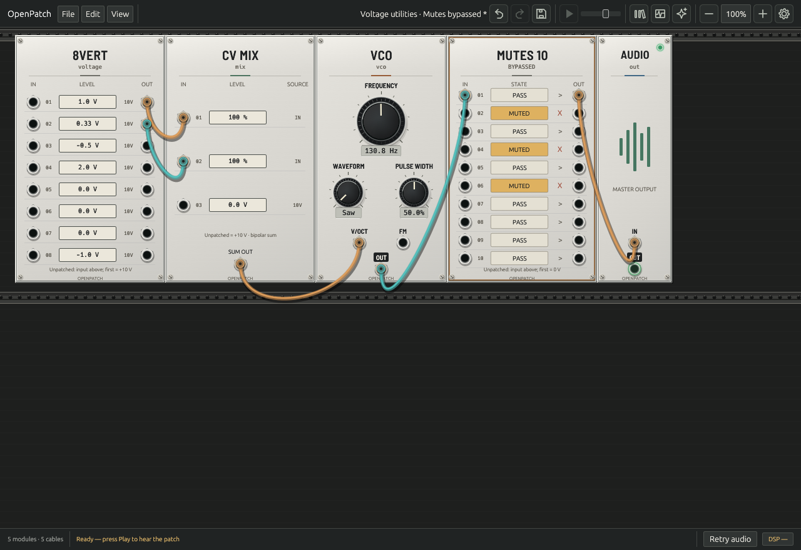

Right-click a panel to bypass it. The amber border identifies the saved bypass
state; controls and cables stay editable. Bypass and mute inversion share the
same undo history through the UI and MCP.

<sub>Native Linux / Mesa CI renders. Signal behavior is tested offline; these
images do not establish live audio-device qualification.</sub>

[Normaling, polyphony, and bypass behavior →](docs/VOLTAGE_UTILITIES.md)

</details>

<details>
<summary><strong>Shape gates and hold a moving pitch</strong></summary>

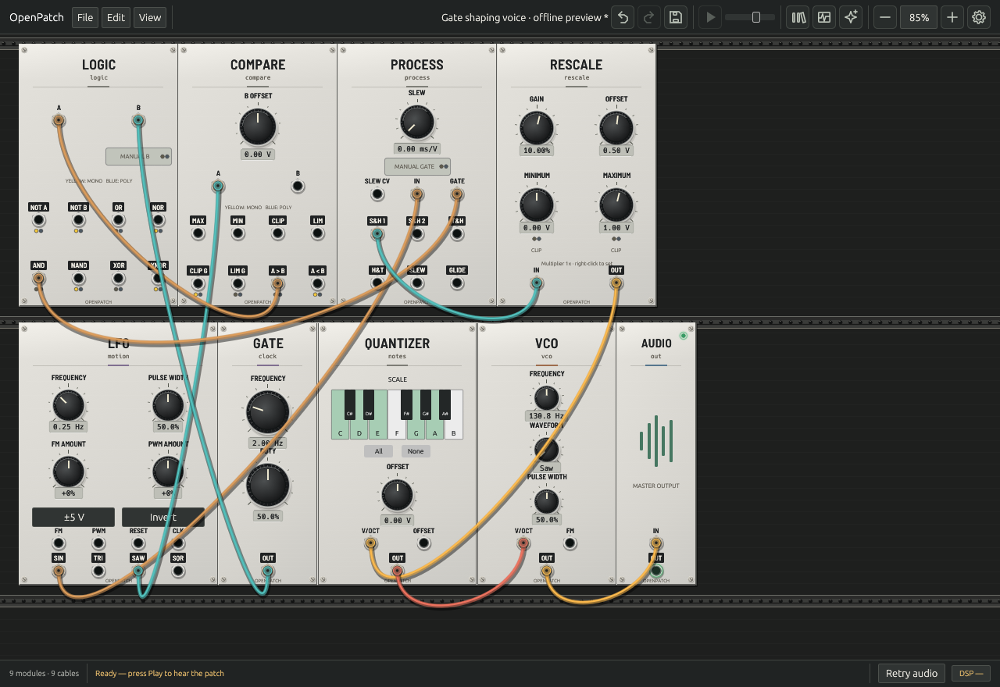

Choose **File → Gate shaping voice**. Compare turns modulation into gates,
Logic combines them with a clock, and Process samples a moving voltage.
Rescale sets the range before it reaches the quantizer. Hold either manual
button to override its gate input; release it to return control to the patch.

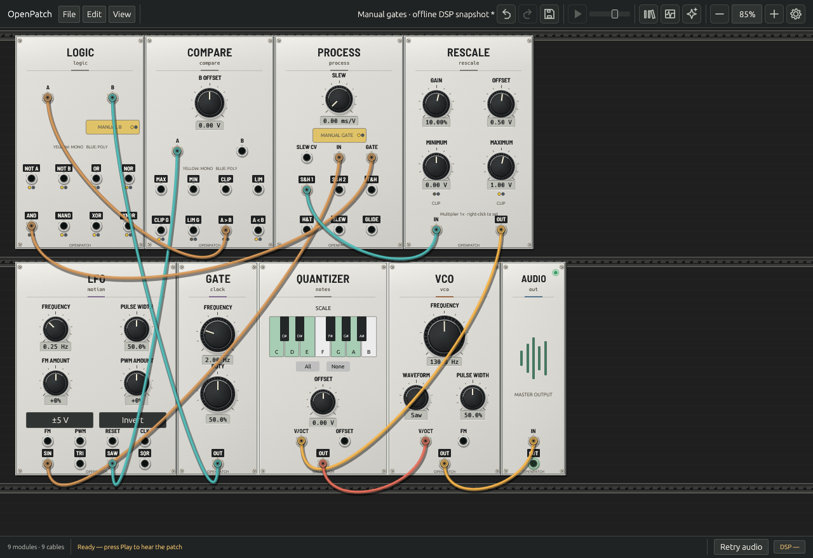

<sub>Native Linux / Mesa CI renders, using offline DSP state. Live macOS
playback qualification remains separate.</sub>

[Signal processing and momentary controls →](docs/SIGNAL_PROCESSING.md)

</details>

<details>
<summary><strong>Make a voice move with a clocked LFO</strong></summary>

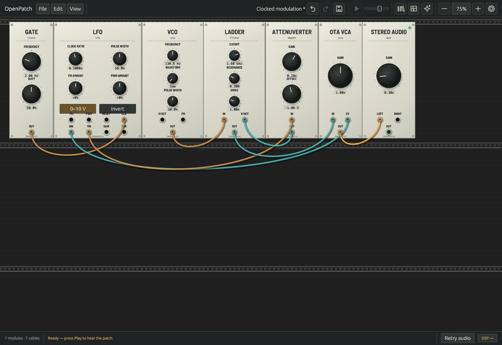

Choose **File → Clocked modulation**. Four simultaneous waveforms let one LFO
shape volume, filter cutoff, and other CV destinations. Patch a clock and the
rate knob displays a multiplier; use reset to align phase independently. FM,
PWM, bipolar/unipolar ranges, and inversion are available directly on the panel.

<sub>Native Linux / Mesa CI render.</sub>

[Modulation controls and signal contract →](docs/MODULATION.md)

</details>

<details>
<summary><strong>Try a clocked random voice</strong></summary>

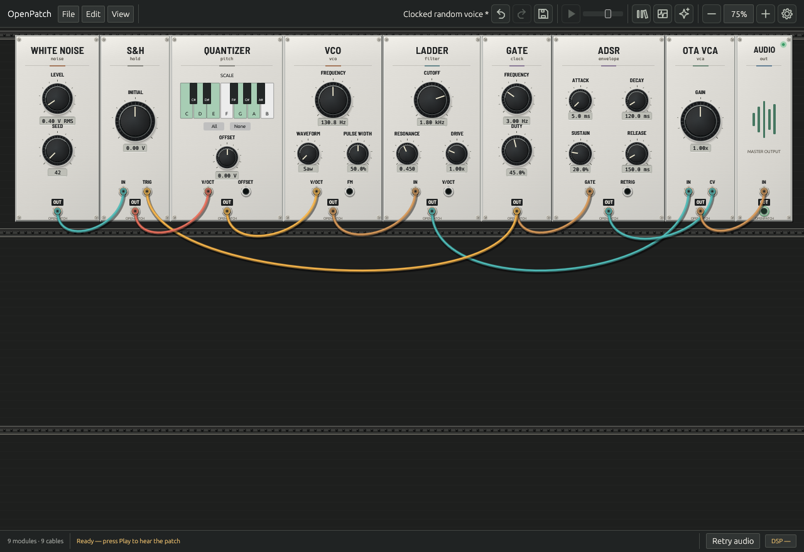

Choose **File → Clocked random voice**. Noise supplies candidate pitches; a clock
samples them, and the quantizer selects notes from a C-major pentatonic scale.
Click its piano keys to change the scale, or edit the seed for another repeatable
sequence. This is an original OpenPatch patch using the documented utility
contracts, not an imported VCV project.

<sub>Native Linux / Mesa CI render.</sub>

</details>

<details>
<summary><strong>Play a polyphonic analog voice</strong></summary>

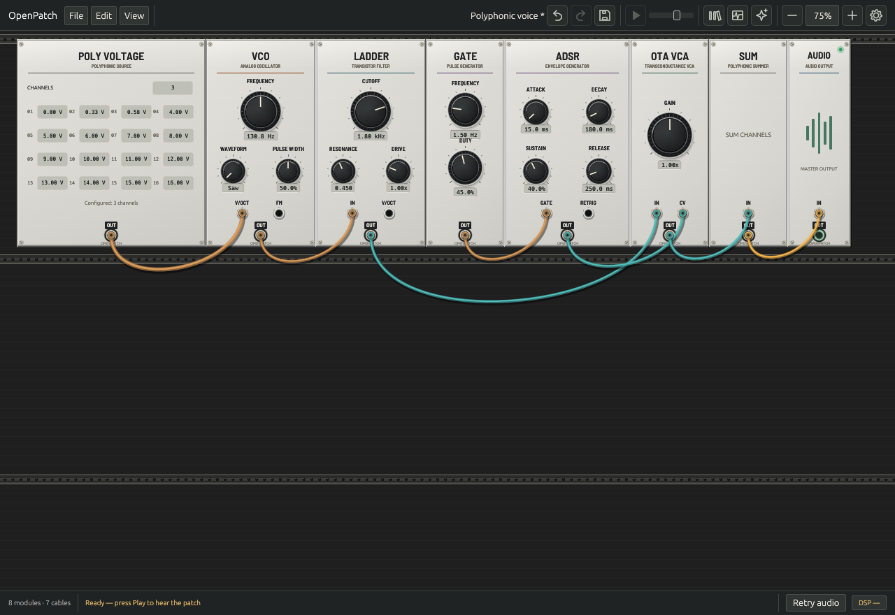

Choose **File → Polyphonic voice**. Three pitch voltages drive independent
oscillator, filter, and VCA states; one envelope controls all three voices.
Change the first three voltage fields to reshape the chord. **SUM** combines
the voices before the audio output. Split and Merge provide individual access
to up to 16 channels for more elaborate routing.

<sub>Native Linux / Mesa CI render. Sixteen-channel routing is supported;
sixteen full circuit voices still exceed realtime CPU capacity in the
[published M1 Max benchmark](docs/PERFORMANCE.md).</sub>

</details>

<details>
<summary><strong>Perform with MIDI or your keyboard</strong></summary>

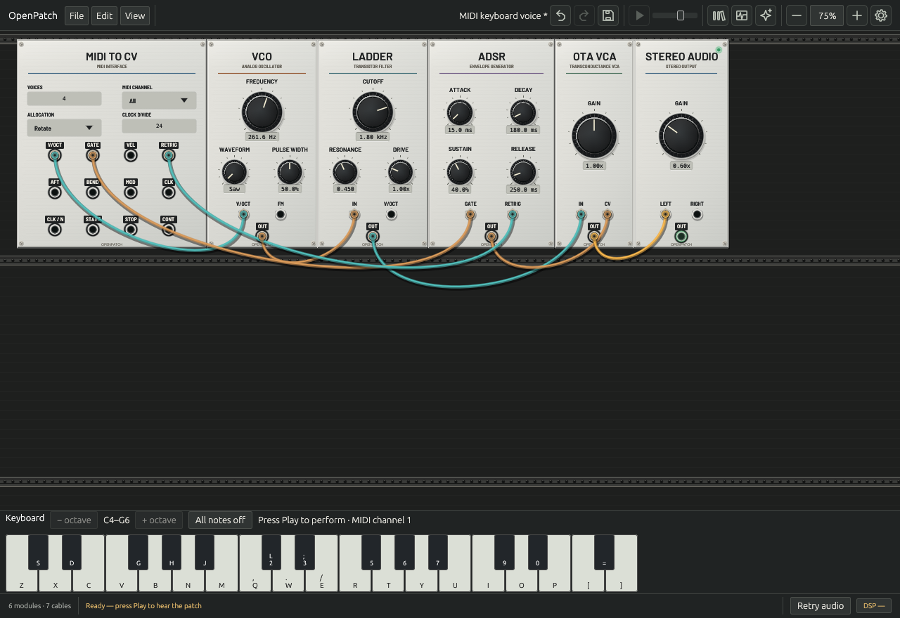

Choose **File → MIDI keyboard voice**, then **Play**. Play 32 pitches with the
`ZXCVB` and `QWERTY` rows or click the piano keys. Backtick and `1` shift octaves;
held notes retain their pitch. **Audio / MIDI** selects your output device and hardware
controller. Sustain, velocity, pitch wheel, clock, and polyphonic voice allocation
are available through the MIDI TO CV panel. The keyboard's **All notes off**
button releases held notes.

Agents can render and inspect repeatable sample-timed MIDI phrases through MCP.
See [MIDI and audio](docs/MIDI_AUDIO.md) for routing, device behavior, and examples.

<sub>Native Linux / Mesa CI render. Physical MIDI hardware still needs qualification.</sub>

</details>

<details>
<summary><strong>Shape a stereo image</strong></summary>

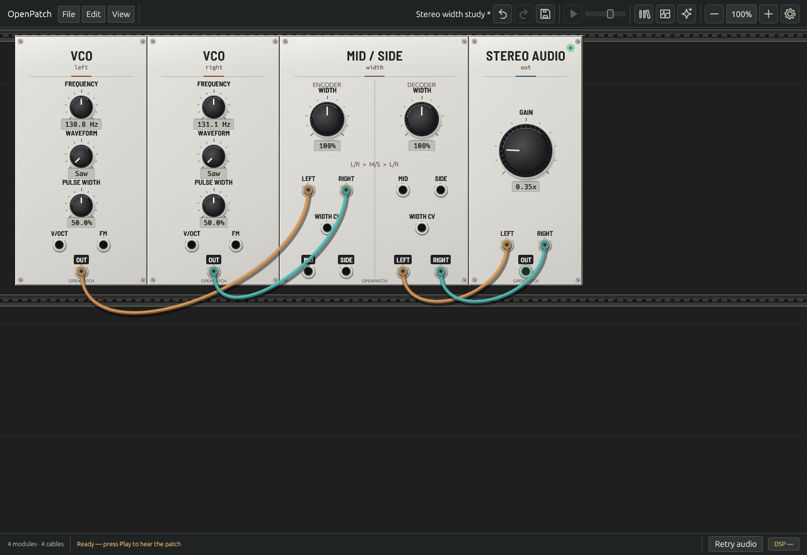

Choose **File → Stereo width study**. Two slightly detuned oscillators feed
MID / SIDE, and its decoder connects to independent L/R audio outputs. Adjust
either Width control to collapse the image to mono or increase its width.

Mix 6 adds six-input mixing, averaging, and polarity inversion. Octave transposes
pitch by whole octaves; Mult distributes an intact polyphonic signal to eight
outputs. Their [signal contracts](docs/ROUTING_MODULES.md) state the voltage,
normaling, and voice behavior explicitly.

<sub>Native Linux / Mesa CI render. Original Rust functional implementations.</sub>

</details>

<details>
<summary><strong>Browse without leaving the rack</strong></summary>

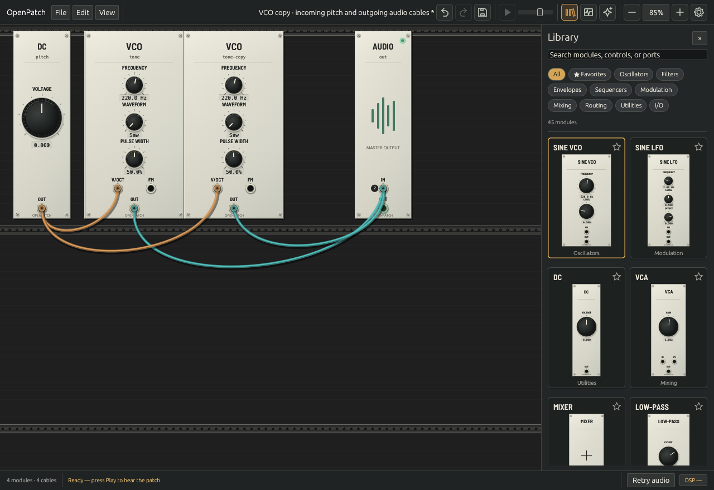

Search module names, controls and ports, filter by musical role, and star favorites.
Drag a tile onto the rack to preview its placement; adding a module is one undo step.
The library stays open while you patch cables and edit controls. Its thumbnails render the actual module panels at their default settings, with the same control layout, typography, knobs, and jacks as the rack. Wide modules get full-width cards. Hover a card for a larger view of the complete panel. [Panel design and preview behavior →](docs/PANEL_DESIGN.md)

<sub>Actual native Linux / Mesa CI render. macOS is the primary design target.</sub>

</details>

## Claude & Codex

Follow the [MCP setup guide](docs/MCP.md) for Claude Code, Claude Desktop, or Codex configuration. The client launches OpenPatch with `--mcp` and controls the live patch in that window. Press **Play** locally to audition changes; agents can also export WAV files without speaker playback.

Each launch owns its own app session. The separate CLI supports headless MCP, offline rendering, and visualizer export.

## Where it stands

**Parity is the baseline:** match VCV Rack Free 2 host functionality and the 49 Core / Free modules, then extend usability, performance, visuals, and agent control. The [parity roadmap](docs/ROADMAP.md) tracks concrete acceptance gates. OpenPatch has not reached parity yet.

**51 built-in kinds:** a four-output audio oscillator, a reference analog voice, [four-track scores and studio effects](docs/SCORE_AND_STUDIO.md), sequencer, sequential switches, ten-row [Pulses](docs/PULSES.md), latching [Push](docs/PUSH.md), polyphonic [Gates](docs/GATES.md), voltage, gate-processing and polyphonic utilities, MIDI → CV, stereo audio, and legacy modules. Try the connected examples in **File**, then drag modules from the docked library. Search controls and ports, filter by musical role, and save favorites without leaving the rack. Saved module bypass and atomic mute inversion share the UI and MCP history. The [module coverage plan](docs/MODULE_COVERAGE.md) tracks **49 VCV Core / Free targets**; kind count is not a count of completed equivalents.

macOS ARM is the current product focus. CI builds and tests **macOS ARM64, Linux x86-64, and Windows x86-64**, including native window and shader checks on Linux. Audio devices and GPU drivers need broader hands-on testing.

**File → Save template** sets your reusable starting patch. **New / Cmd-Ctrl-N** opens it as a clean, untitled project; missing or invalid templates fall back to the factory analog voice. See [projects and recovery](docs/PROJECTS.md).

Factory patches use the [version-2 engine](docs/ENGINE_V2.md): named outputs, up to 16 channels per cable, and feedback with one sample of delay per cable. Old patches retain their original mono timing until explicitly converted. The explicit **STEREO AUDIO** sink sums polyphonic voices into left/right output and stereo WAV files; other selected outputs retain channel-0 mono behavior. Hardware audio input, expanded multichannel I/O, MIDI output/mapping, VCV patch/plugin compatibility, and broader module coverage remain ahead. See [MIDI and audio](docs/MIDI_AUDIO.md) for performance controls and sample-timed MCP traces.

**Performance goal:** low CPU use and predictable audio deadlines on large patches. The latest paired M1 Max reference-voice benchmark takes about **33% less processing time** than the previous OpenPatch build, with matching checked signals. Sixteen full circuit voices still exceed realtime capacity. Callback tests check allocation-free processing and graph swaps. A speedup over VCV Rack has **not** been demonstrated; see the [results and methodology](docs/PERFORMANCE.md).

## Go deeper

| Guide | What it covers |
|---|---|
| [Rack editing](docs/RACK_EDITING.md) | Group selection, duplication, placement, cable-copy policies, and runtime identity |
| [Stacked cables](docs/STACKED_CABLES.md) | Input summing, polyphonic modulation, individual cable editing, and MCP routing |
| [Projects and recovery](docs/PROJECTS.md) | Save, Save As, legacy imports, concurrent edits, and recovery copies |
| [Module presets](docs/MODULE_PRESETS.md) | Capture, preview, save and load native presets from the rack or MCP |
| [Stereo and routing](docs/ROUTING_MODULES.md) | Mid/Side width, six-input mixing, octave shifts, and signal distribution |
| [Voltage-controlled mixing](docs/VOLTAGE_MIXING.md) | Four-channel VCA mixing, live strip meters, CV response, and complementary fades |
| [MIDI and audio](docs/MIDI_AUDIO.md) | Keyboard performance, input devices, stereo routing, and reproducible agent performances |
| [Engine v2](docs/ENGINE_V2.md) | Named ports, polyphony, feedback timing, state migration, and legacy compatibility |
| [Analog models](docs/ANALOG_MODELS.md) | Circuit equations, voltage conventions, reference comparisons, and limits |
| [Parity roadmap](docs/ROADMAP.md) | Host functionality, acceptance gates, delivery order, and MCP expansion |
| [Audio oscillator](docs/AUDIO_OSCILLATOR.md) | Polyphonic FM, PWM, sync and measured compatibility gaps |
| [Module coverage](docs/MODULE_COVERAGE.md) | The 49 Core / Free targets and acceptance criteria |
| [MCP integration](docs/MCP.md) | Client configuration, tools, revision checks, and file safety |
| [Visualizers](docs/VISUALIZERS.md) | Native rendering, shader uniforms, and optional HTML export |
| [Architecture](docs/ARCHITECTURE.md) | DSP, audio/control thread boundaries, persistence, and roadmap |
| [Performance](docs/PERFORMANCE.md) | Benchmarks and fair comparisons |

<details>
<summary><strong>Linux, Windows, and contributor checks</strong></summary>

Linux requires ALSA, udev, XKB, Wayland, and OpenGL development libraries. On Debian / Ubuntu:

```sh
sudo apt-get install libasound2-dev libudev-dev libxkbcommon-dev libxkbcommon-x11-dev libwayland-dev libgl1-mesa-dev
cargo run --locked --release -p openpatch-desktop
```

Windows requires stable Rust with the MSVC toolchain and C++ build tools. Run the same Cargo command; use `python` instead of `python3` for repository scripts.

```sh
cargo fmt --all -- --check
cargo clippy --locked --workspace --all-targets -- -D warnings
cargo test --locked --workspace
cargo build --locked --release --workspace
python3 -m unittest discover -s scripts -v
cargo bench --locked -p openpatch-core
```

See the [CI workflow](.github/workflows/ci.yml) for the platform build matrix and native smoke tests.

</details>

---

[MIT licensed](LICENSE). Original Rust code and artwork. OpenPatch is independent of VCV and is not affiliated with or endorsed by VCV. Dependency licenses remain with their respective authors. Panel typography uses [Barlow Semi Condensed](crates/openpatch-desktop/assets/fonts/README.md) under the SIL Open Font License; its notice is bundled with the Mac app and available with `openpatch-desktop --font-license`.
