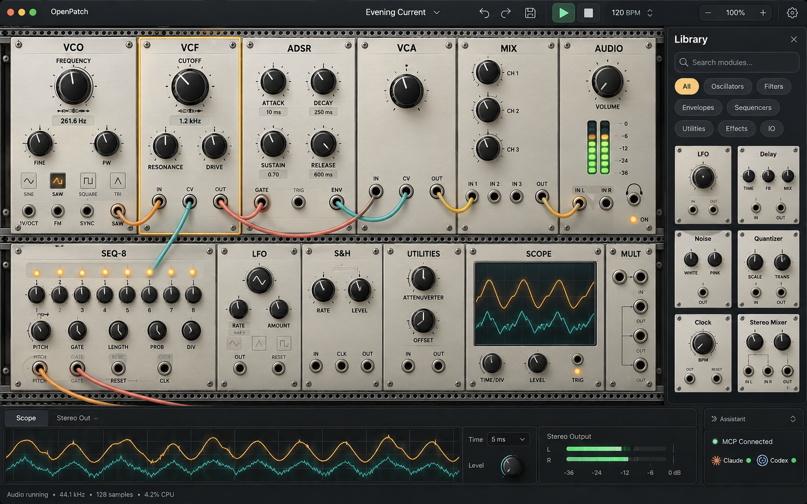
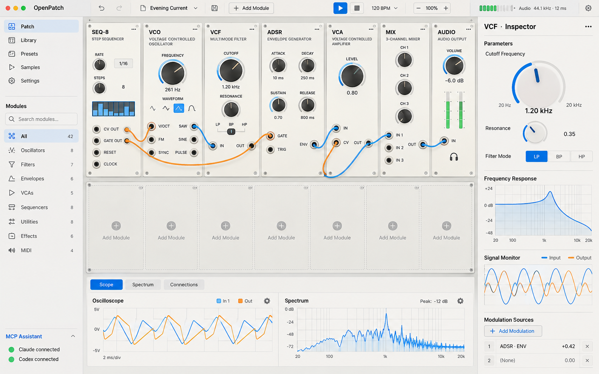
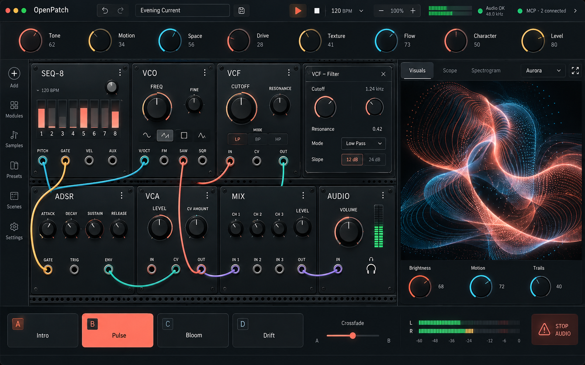
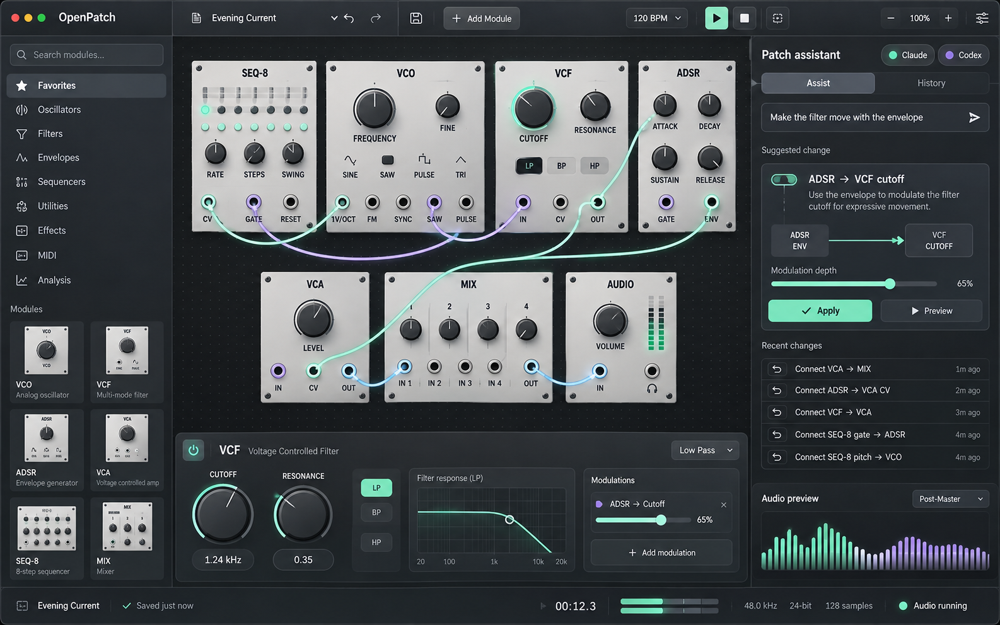

# OpenPatch UI redesign concepts

Generated with the built-in image generation tool on 2026-10-13. These are visual explorations, not implemented interfaces or validated electrical patch diagrams. Some generated cable endpoints and labels are imperfect; implementation must use the actual module port schemas and signal rules.

| Concept | Design emphasis |
|---|---|
| 01 — Studio Rack | Tactile hardware panels, rack-first workspace, module thumbnail library |
| 02 — Precision Lab | Signal inspection, circuit tuning, response and waveform plots |
| 03 — Live Canvas | Performance macros, scenes, large audio-reactive visualizer |
| 04 — Modern Modular | Native desktop organization, contextual inspector, patch assistance |

Selected direction: **01 — Studio Rack**, chosen by the user on 2026-10-13. Use its rack-first composition, warm aluminum faceplates, tactile dark controls, restrained amber lighting and clear cable paths as the native application's visual foundation. The other concepts remain alternatives for future exploration, not approved replacements for this direction.

Implementation starts with procedural rack materials and matching graphite application chrome. The reference's docked thumbnail library, transport layout and integrated measurement dock require subsequent interaction work; this first material pass does not implement the entire mockup. Keep actual port definitions, control geometry and signal behavior authoritative over generated details.

## Native implementation progress

The first pass adds smoothly lit warm aluminum panels, beveled edges, machined knobs, recessed jacks, amber selection outlines, raised cable shading and graphite application controls. Existing control positions and patching interactions remain in place. This is an actual Linux/Mesa native render from [commit 4483066](https://github.com/dexterlabs1/openpatch/commit/448306620e42f72edab2767a9cd8455660af4ffe), separate from the generated concepts below; it does not establish macOS device or playback qualification.

## Visual previews

### Studio Rack

### Precision Lab

### Live Canvas

### Modern Modular

## Generation prompts

### 01-studio-rack

Use case: ui-mockup. Create one high-fidelity redesign concept for OpenPatch, a native macOS modular synthesizer desktop application built in Rust. Single complete app screenshot, landscape 16:10, high resolution, edge-to-edge app window, no surrounding computer, no browser, no marketing page, no perspective tilt, no multiple screens or collage. Design from a senior product/UI designer perspective, polished usable professional music creation software. Include restrained macOS traffic lights and app title OpenPatch. A real modular rack remains the primary instrument: modules VCO, VCF, ADSR, VCA, SEQ-8, MIX and AUDIO, with readable parameter names, large useful knobs and distinct labeled input/output jacks. Show a plausible patch: sequencer pitch to VCO pitch, sequencer gate to ADSR gate, VCO saw to VCF audio input, VCF output to VCA audio input, ADSR envelope to VCA CV, VCA output to MIX then AUDIO. A few graceful cable curves with plausible connected endpoints, restrained semitransparency so labels stay readable. Clear interactive hierarchy, professional typography, alignment, consistent icons, comfortable hit areas. Include patch name 'Evening Current', undo/redo, save, add module, audio play/stop, tempo 120, zoom, and understated audio status. Include contextual selected module controls and integrated visualizer plus a compact MCP connection indicator for Claude and Codex. These are aspirational mockups, not claims about current implementation. Avoid excessive tiny text, lorem ipsum, fantasy illegible controls, gratuitous glow, web dashboard cards, pricing, promo headlines, excessive empty space.
Design direction STUDIO RACK: Closest to a beautiful physical Eurorack and VCV Rack workflow. Dominant spacious two-row metal rack across about 78 percent of window; warm off-white brushed aluminum module faceplates on charcoal rack rails, subtle screws, tactile dark rotary knobs with crisp indicators, small amber status LEDs, natural restrained panel shadows. First row a complete analog voice, second row sequencer, utilities and scope, with room for expansion. Color coded amber, coral and teal cables, modest cable sag. Compact top chrome dark graphite. Narrow right sidebar 'Library' with a search field, category pills and six small realistic module thumbnails ready to drag into the rack. Bottom dock a slim oscilloscope and stereo output meter; tiny collapsed 'Assistant' affordance and connected MCP status. A selected VCF gets a slim amber edge highlight and readable cutoff value. Make the rack generous and elegant, physical but not cheesy skeuomorphism, mature music production tool. Clearly show excellent cable visibility and subtle jack hover highlight.

### 02-precision-lab

Use case: ui-mockup. Create one high-fidelity redesign concept for OpenPatch, a native macOS modular synthesizer desktop application built in Rust. Single complete app screenshot, landscape 16:10, high resolution, edge-to-edge app window, no surrounding computer, no browser, no marketing page, no perspective tilt, no multiple screens or collage. Design from a senior product/UI designer perspective, polished usable professional music creation software. Include restrained macOS traffic lights and app title OpenPatch. A real modular rack remains the primary instrument: modules VCO, VCF, ADSR, VCA, SEQ-8, MIX and AUDIO, with readable parameter names, large useful knobs and distinct labeled input/output jacks. Show a plausible patch: sequencer pitch to VCO pitch, sequencer gate to ADSR gate, VCO saw to VCF audio input, VCF output to VCA audio input, ADSR envelope to VCA CV, VCA output to MIX then AUDIO. A few graceful cable curves with plausible connected endpoints, restrained semitransparency so labels stay readable. Clear interactive hierarchy, professional typography, alignment, consistent icons, comfortable hit areas. Include patch name 'Evening Current', undo/redo, save, add module, audio play/stop, tempo 120, zoom, and understated audio status. Include contextual selected module controls and integrated visualizer plus a compact MCP connection indicator for Claude and Codex. These are aspirational mockups, not claims about current implementation. Avoid excessive tiny text, lorem ipsum, fantasy illegible controls, gratuitous glow, web dashboard cards, pricing, promo headlines, excessive empty space.
Design direction PRECISION LAB: A contemporary circuit measurement workbench with a bright warm-gray/off-white background, near-black typography, precise blue and burnt-orange accents. Reorganize entire app: slim left navigation rail and expandable compact module catalog occupy 15 percent, two rows of flat refined ivory and pale gray rack modules occupy center 60 percent, a 25 percent right inspection panel has meaningful controls for selected VCF and readable scientific signal plots. Right panel title 'VCF · Inspector', big cutoff control 1.20 kHz, resonance knob, clean frequency response graph with logarithmic frequency labels, small 'Input' and 'Output' waveform comparison, a modulation source list. Rack modules use crisp technical scale markings and graphic knob rings, not glossy hardware. Bottom horizontal dock spans rack area with oscilloscope and spectrum, tabs 'Scope', 'Spectrum', 'Connections'; subtle voltage labels at hovered ports. Blue audio cables, orange CV cables, dotted subtle selected-route emphasis. MCP assistant as a small bottom-left activity strip with 'Claude connected' and 'Codex connected'. Engineering accuracy and discoverability without overwhelming beginners. Distinctive calm editorial precision, dense useful workspace, clean large readable text.

### 03-live-canvas

Use case: ui-mockup. Create one high-fidelity redesign concept for OpenPatch, a native macOS modular synthesizer desktop application built in Rust. Single complete app screenshot, landscape 16:10, high resolution, edge-to-edge app window, no surrounding computer, no browser, no marketing page, no perspective tilt, no multiple screens or collage. Design from a senior product/UI designer perspective, polished usable professional music creation software. Include restrained macOS traffic lights and app title OpenPatch. A real modular rack remains the primary instrument: modules VCO, VCF, ADSR, VCA, SEQ-8, MIX and AUDIO, with readable parameter names, large useful knobs and distinct labeled input/output jacks. Show a plausible patch: sequencer pitch to VCO pitch, sequencer gate to ADSR gate, VCO saw to VCF audio input, VCF output to VCA audio input, ADSR envelope to VCA CV, VCA output to MIX then AUDIO. A few graceful cable curves with plausible connected endpoints, restrained semitransparency so labels stay readable. Clear interactive hierarchy, professional typography, alignment, consistent icons, comfortable hit areas. Include patch name 'Evening Current', undo/redo, save, add module, audio play/stop, tempo 120, zoom, and understated audio status. Include contextual selected module controls and integrated visualizer plus a compact MCP connection indicator for Claude and Codex. These are aspirational mockups, not claims about current implementation. Avoid excessive tiny text, lorem ipsum, fantasy illegible controls, gratuitous glow, web dashboard cards, pricing, promo headlines, excessive empty space.
Design direction LIVE CANVAS: A performance-oriented midnight-black graphite instrument with rich but restrained coral, warm amber and electric cyan highlights. Reorganize the entire window for live play: top compact transport and eight large labeled macro controls 'Tone', 'Motion', 'Space', 'Drive' etc in a wide performance strip; main middle region has an expansive two-row modular rack on left about 65 percent width, and a large beautiful live GLSL audio-reactive visualizer on right about 35 percent. Visualizer is an elegant luminous flowing interference sculpture, warm coral ribbons and blue fine lines on near-black, treated as part of real software with small 'Visuals' tab, 'Aurora' preset, 'Full screen' icon, and three practical controls below. Modules are dark anodized metal with highly readable cream labels and large rings, a sequencer row shows eight illuminated active steps. Cable curves carefully organized, vivid selected path, other cables muted. Bottom strip has four large scene buttons 'Intro', 'Pulse', 'Bloom', 'Drift', a crossfade control, stereo level meter and emergency audio stop. Module browser lives as a narrow collapsed left rail with add button, contextual inspector is a compact floating panel anchored to selected filter, not a tall sidebar. Tiny 'MCP · 2 connected' indicator. Looks like an actual premium modular performance workstation, not a neon sci-fi HUD. Rack still the main musical editing surface.

### 04-modern-modular

Use case: ui-mockup. Create one high-fidelity redesign concept for OpenPatch, a native macOS modular synthesizer desktop application built in Rust. Single complete app screenshot, landscape 16:10, high resolution, edge-to-edge app window, no surrounding computer, no browser, no marketing page, no perspective tilt, no multiple screens or collage. Design from a senior product/UI designer perspective, polished usable professional music creation software. Include restrained macOS traffic lights and app title OpenPatch. A real modular rack remains the primary instrument: modules VCO, VCF, ADSR, VCA, SEQ-8, MIX and AUDIO, with readable parameter names, large useful knobs and distinct labeled input/output jacks. Show a plausible patch: sequencer pitch to VCO pitch, sequencer gate to ADSR gate, VCO saw to VCF audio input, VCF output to VCA audio input, ADSR envelope to VCA CV, VCA output to MIX then AUDIO. A few graceful cable curves with plausible connected endpoints, restrained semitransparency so labels stay readable. Clear interactive hierarchy, professional typography, alignment, consistent icons, comfortable hit areas. Include patch name 'Evening Current', undo/redo, save, add module, audio play/stop, tempo 120, zoom, and understated audio status. Include contextual selected module controls and integrated visualizer plus a compact MCP connection indicator for Claude and Codex. These are aspirational mockups, not claims about current implementation. Avoid excessive tiny text, lorem ipsum, fantasy illegible controls, gratuitous glow, web dashboard cards, pricing, promo headlines, excessive empty space.
Design direction MODERN MODULAR: A refined native Mac creative application, minimalist professional graphite and soft silver surfaces, subtle frosted sidebar only, mint and muted lavender accents. Reorganize the app: thin top native toolbar, left 17 percent width library sidebar with search, 'Favorites', 'Oscillators', 'Filters', 'Envelopes', 'Utilities', elegant small module previews; center 61 percent width infinite rack canvas with two clean spacious rows of modular panels on a charcoal background; right 22 percent width integrated assistant sidebar titled 'Patch assistant'. Rack panels are unified light cool-gray with dark compact typography, very legible ports and beautiful simple knobs, minimal screws, thin section rules. Colors reserved for cable signal roles; curved cables are selectively dimmed with a selected mint route and clear highlighted destination jack. Contextual bottom inspector under rack shows selected VCF cutoff and resonance, tiny response plot and modulation assignments. Assistant is task-based, not a wall of chat: tabs 'Assist' and 'History', small Claude and Codex connection pills, prompt 'Make the filter move with the envelope', a tasteful proposed change preview 'ADSR → VCF cutoff' with modulation depth control and clear 'Apply' button, plus undoable recent changes list. Bottom-right of assistant a compact gorgeous audio-reactive visual preview; transport/audio meters in bottom status bar. Feels like a carefully designed native creative tool with user agency and excellent workflow, not a generic web SaaS dashboard. Product-quality subtlety, crisp pixel-aligned controls.

