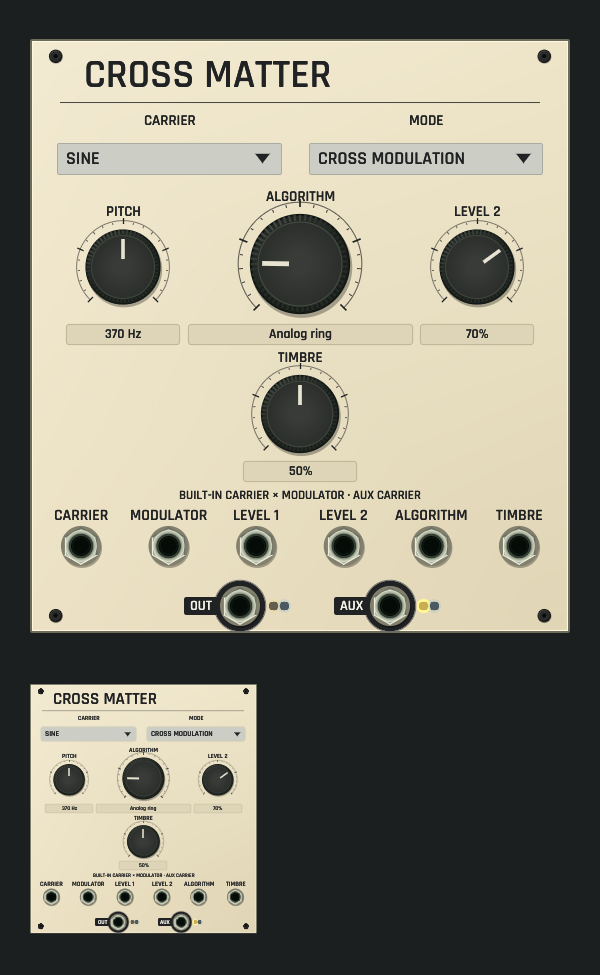

# Cross Matter shared panel review

Development candidate, not installed. [Source and native contract](../../../docs/CROSS_MATTER.md).

CPU rendering of the actual shared ModulePreview/rack surface on macOS ARM, at
full size and 42% thumbnail scale, using the selected application font. The
default face shows the built-in sine carrier: LEVEL 1 reads as PITCH in Hz, the
large ALGORITHM rotary names its source region, and the guide line states the
configured path. Two selectors, four rotaries, six inputs and two outputs with
lamps share the rack and browser renderer. Lamps come from actual offline Core
processing (60,000 frames); AUX is lit by the built-in carrier, OUT stays dark
because nothing is patched into MODULATOR. No audio device or window is opened.

Focused tests check print, rotary/value targets, selectors and port rims at
five scales, mode-dependent captions and readouts (vocoder, pitch, shift, phase),
revision-fenced drag edits sharing one undo gesture, and measured bipolar lamps.

[Dim-room capture with the same real lamp state](dim-panel-and-thumbnail.png).
The local lamp stays visible while unlit controls and print dim with the room.

Capture: `export_panel_design_preview` with `OPENPATCH_PANEL_KINDS=cross_matter`,
`OPENPATCH_PANEL_SCALE=1.5`, `OPENPATCH_PANEL_ENGINE_STATE=1` and an explicit
`OPENPATCH_PANEL_PREVIEW` path; dim capture adds `OPENPATCH_PANEL_LIGHT=0.12`.
