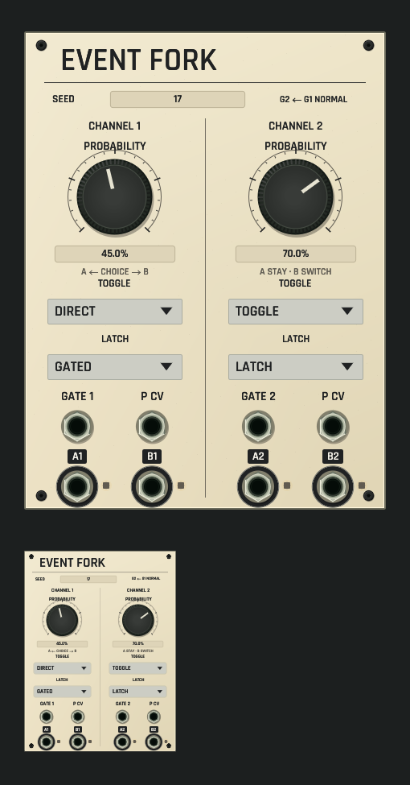

# Event Fork shared panel review

Development candidate, not installed. [Source and native contract](../../../docs/EVENT_FORK.md).

CPU rendering of the real rack/browser surface on macOS ARM. Both panels use the same renderer, at full and 42% scale. Authored settings come from the [routed duet example](../../../examples/event-fork-routed-duet.json). The 20 HP face has two large probability knobs, independently saved toggle/latch controls, guarded exact seed entry, eight enlarged ports, the selected application font and seated black fasteners. G2 ← G1 describes the actual physical input normal; toggle captions describe stay/switch decisions.

This is an isolated panel with no input cables: actual offline Core processing publishes four dark output lamps. It does not fabricate a gate, trace or glowing activity. The full example supplies clock gates and uses A/B to play two quiet voices while section 2 holds filter CV. Focused checks separately prove actual telemetry versus absent telemetry, all eight cable targets, native knob/seed/revision/history gestures, MCP anchors and five-scale geometry. The exhaustive default shared-renderer guard includes all 90 development catalog kinds.

[Dim-room view of the same state](dim-panel-and-thumbnail.png). Unlit controls dim with the panel; no emissive wash is added. No native window or audio device is opened.

Capture uses `export_panel_design_preview` with `OPENPATCH_PANEL_KINDS=event_fork`, `OPENPATCH_PANEL_PROJECT=examples/event-fork-routed-duet.json`, `OPENPATCH_PANEL_SCALE=1.5`, `OPENPATCH_PANEL_ENGINE_STATE=1` and an explicit output path. The dim capture sets `OPENPATCH_PANEL_LIGHT=0.12`.
