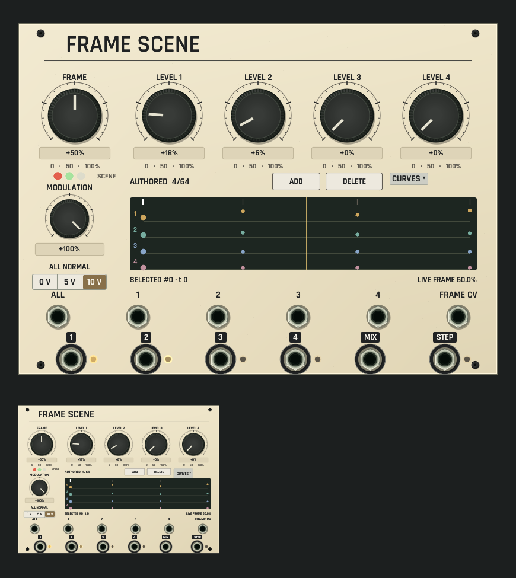

# Frame Scene shared panel review

Development candidate, not installed. [Source and native behavior contract](../../../docs/FRAME_SCENE.md).

CPU capture of the actual shared rack/browser renderer on macOS ARM, using the authored four-key scene from the [evolving voice example](../../../examples/frame-scene-evolving-voice.json). The smaller panel uses the same renderer at 42% scale, rather than separate thumbnail artwork. Five large rotary controls, modulation, normalled-voltage selector, anchored curve settings, stable-ID scene editing and enlarged sockets use the existing Signal Atlas language. The lower output grid clears the seated mounting screws; geometry checks cover these rims and controls at five scales.

The four timeline lanes show authored keyframe values. The selected key is #0 at timestamp 0, so its LEVEL controls display that stored scene rather than the live interpolation. The FRAME control is configured at 50%. The LIVE playhead, RGB scene lamps and actual gain indicators come from 60,000 frames of offline Core processing of this module. This isolated-panel capture has no external modulation input; the full example supplies a Tidal Functions LFO. No native window or audio device is opened, and the authored timeline is not presented as an audio scope.

[Dim-room capture using the same real offline telemetry](dim-panel-and-thumbnail.png). Only local lamps remain lit; no broad glow wash is added. Hardware VCA calibration and physical light output are outside this native qualification.

Focused UI checks cover stored/manual level edits, stable-ID movement, grouped undo gestures, telemetry absence, MCP control anchors, accepted own-revision echoes and cancellation after external edits/focus loss. The separate inventory guard draws every default catalog kind through the same rack/browser surface. Presets, save/reopen and shared MCP authoring have separate workflow evidence.

Capture uses `export_panel_design_preview` with `OPENPATCH_PANEL_KINDS=frame_scene`, `OPENPATCH_PANEL_PROJECT` set to the example, `OPENPATCH_PANEL_SCALE=1.5`, `OPENPATCH_PANEL_ENGINE_STATE=1` and an explicit `OPENPATCH_PANEL_PREVIEW` output path; the dim capture adds `OPENPATCH_PANEL_LIGHT=0.12`.
