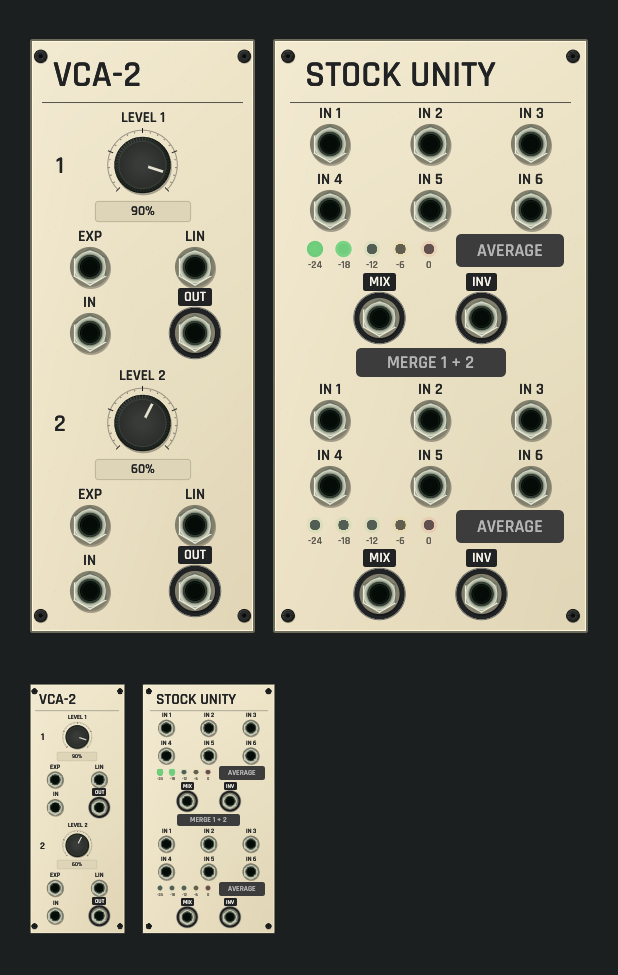

# VCA-2 and Unity shared panel review

Development candidate, not installed. Contracts: [VCA-2](../../../docs/STOCK_VCA2.md) and [Unity](../../../docs/STOCK_UNITY.md).

CPU rendering of the actual shared ModulePreview/rack surface on macOS ARM, at
full size and 42% thumbnail scale, using the selected application font. No
window, audio device or speaker is opened.

VCA-2 (10 HP) stacks its two identical channels: a channel number, a LEVEL
rotary with a percent readout, EXP and LIN CV inputs, then IN and OUT. The
source has no lights or meters, so the face shows none. The authored levels
come from the duet example (90% and 60%).

Unity (14 HP) stacks its two six-input sections. Each has six inputs, five
level lamps marked -24, -18, -12, -6 and 0 dB (the source's green, yellow and
red), an AVERAGE toggle and MIX/INV outputs; MERGE 1 + 2 sits between the
sections. The lamps are driven only by offline Core processing of the whole
duet example (60,000 frames): section 1 carries both amplified voices and
lights its -24 and -18 dB lamps, section 2 has nothing patched and stays dark.

Focused tests check print, rotary/value targets, toggles, lamps and port rims
at five scales, readouts, a revision-fenced drag edit with one undo gesture,
each toggle's edit and lamps following measured state.

[Dim-room capture with the same real lamp state](dim-panel-and-thumbnail.png).
Unlit controls and print dim with the room; lit lamps keep a restrained halo.

Capture: `export_panel_design_preview` with
`OPENPATCH_PANEL_KINDS=stock_vca2,stock_unity`, `OPENPATCH_PANEL_SCALE=1.5`,
`OPENPATCH_PANEL_ENGINE_STATE=1`, `OPENPATCH_PANEL_ENGINE_PROJECT=1`,
`OPENPATCH_PANEL_PROJECT` set to the absolute path of
`examples/legacy-vca2-unity-duet.json` and an explicit
`OPENPATCH_PANEL_PREVIEW` path; the dim capture adds `OPENPATCH_PANEL_LIGHT=0.12`.
`OPENPATCH_PANEL_ENGINE_PROJECT` is a new opt-in: it processes the whole
authored project so lamps show what the module measures with the example's
cables, while the drawn module itself stays unpatched.
