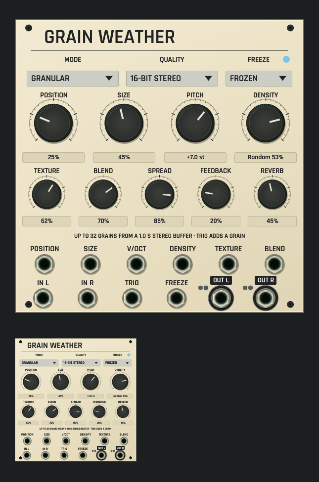

# Grain Weather shared panel review

Development candidate, not installed. [Source and native contract](../../../docs/GRAIN_WEATHER.md).

CPU rendering of the actual shared ModulePreview/rack surface on macOS ARM, at
full size and 42% thumbnail scale, using the selected application font. The
authored face is granular mode with FREEZE on: three selectors (mode, buffer
quality, freeze), four large rotaries (position, size, pitch, density) and five
smaller ones (texture, blend, spread, feedback, reverb), each with a plain-word
caption and a readout in its own unit (percent, signed semitones, or the
granular density reading "Random 53%"). The guide line states the configured
buffer and what TRIG does. Six CV inputs sit under the controls they modulate;
audio, trigger and freeze inputs and both outputs run along the bottom, clear
of the corner screws. The freeze lamp beside the FREEZE caption is lit from
actual offline Core processing (60,000 frames); the output lamps stay dark
because nothing is patched into the inputs. No audio device or window is
opened.

Captions follow the mode (stretch: WINDOW, DIFFUSION, FILTER; looping delay:
DELAY; spectral: WARP, REFRESH, QUANTIZE). Focused tests check print,
rotary/value targets, selectors and port rims at five scales, mode- and
quality-dependent captions, readouts and guide text, revision-fenced drag edits
sharing one undo gesture, and measured output and freeze lamps.

[Dim-room capture with the same real lamp state](dim-panel-and-thumbnail.png).
The local lamp stays visible while unlit controls and print dim with the room.

Capture: `export_panel_design_preview` with `OPENPATCH_PANEL_KINDS=grain_weather`,
`OPENPATCH_PANEL_SCALE=1.5`, `OPENPATCH_PANEL_ENGINE_STATE=1`, an authored
`OPENPATCH_PANEL_PROJECT` (granular, freeze on) and an explicit
`OPENPATCH_PANEL_PREVIEW` path; dim capture adds `OPENPATCH_PANEL_LIGHT=0.12`.
