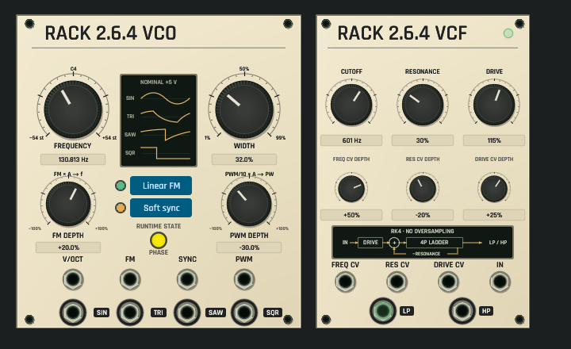
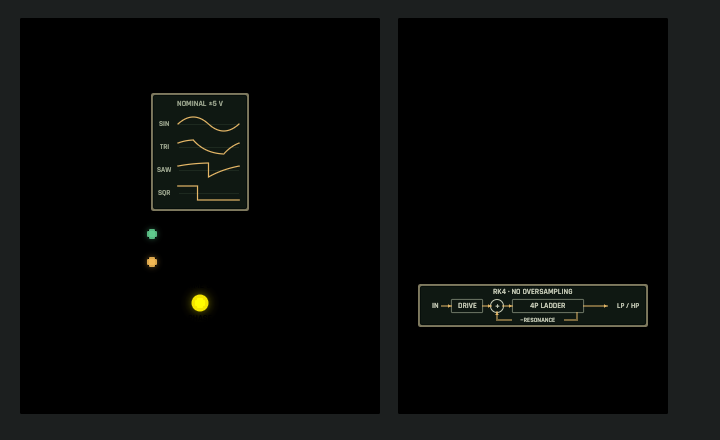
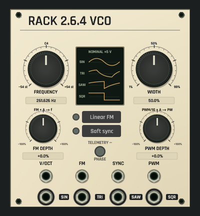
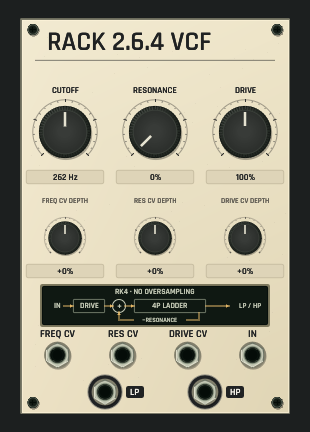

# Rack 2.6.4 voice panel review

Actual shared egui panel drawing, CPU-rasterized with the bundled font atlas.
No native window, GPU context or audio device is opened. These are panel-only
captures; rack rails and cable/plug overlays are outside this review frame.
The normal/dark fixture processes the actual Core voice and observes real VCO
lamp state. Browser panels use catalog defaults and no invented activity.

Both views share the rack renderer, controls, typography, materials and named
ports. VCO guides show configured curved source waves, without claiming a live
scope or BLEP response. The VCF guide identifies its non-oversampled ladder.
The source-specific semitone/cutoff limits and signed controls are interactive;
the newer Stock panels retain their previous bounds.

Reproduce with `OPENPATCH_RACK264_REVIEW_DIR=/absolute/output` and
`cargo test -p openpatch-desktop rack264_voice_headless_review -- --ignored`.
The exhaustive `every_catalog_preview_matches_actual_default_module_drawing`
check covers all 83 catalog kinds. These captures do not establish native-window
interaction, hardware accuracy or audio-device qualification.
