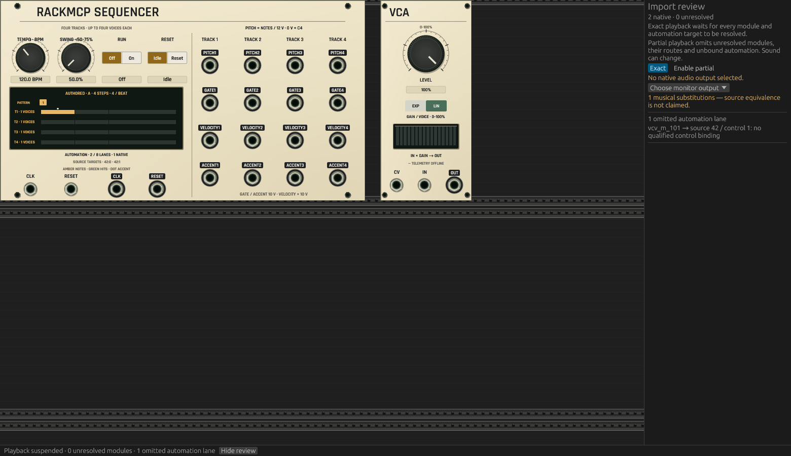

# Imported automation review

Actual shared desktop drawing, CPU-rasterized on macOS ARM without a window,
audio device or GPU context. These views use a synthetic RackMCP 2.0.0 sequencer
and Fundamental 2.6.4 VCA. Source parameter 0 has a qualified native binding;
parameter 1 remains authored and unbound. No signal telemetry is invented.

The inspector discloses the omitted lane even with zero unresolved modules.
Exact playback is suspended; clicking **Enable partial** explicitly permits the
supported subgraph. The mapping is labeled a musical substitution, with its
source-derived host corrections documented in the
[contract](../../../docs/RACKMCP_SEQUENCE_CONTRACT.md#source-import-and-automation-authority).




Reproduce with `OPENPATCH_AUTOMATION_IMPORT_REVIEW` set to a new output directory:

```sh
cargo test -p openpatch-desktop imported_automation_review_suspends_exact
```

This is headless UI evidence. It does not establish native window, driver,
speaker or hardware equivalence. The installed 0.2.6 build 8 remains unchanged.
