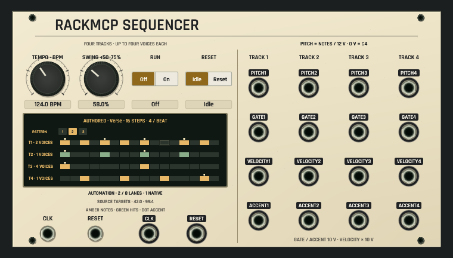
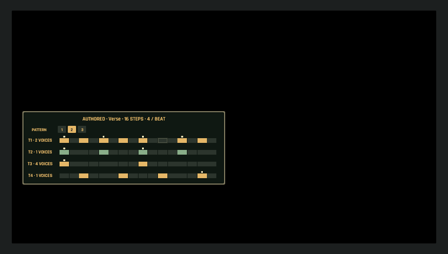
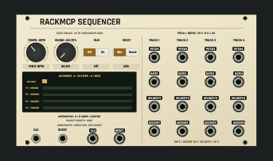

# RackMCP sequencer native panel checkpoint

The dedicated source-version sequencer uses the shared Signal Atlas renderer
for rack modules and browser thumbnails. Controls, output groups and printed
voltage conventions match the native module contract. The overview shows the
saved selected pattern, enabled note steps, pitch-holding drum hits and accents.
It does not claim a live playhead or measured gate activity.







These are actual egui meshes rasterized by the test-only CPU capture helper.
The synthetic authored fixture compiles with one native-bound VCA automation
lane and one retained source-only lane. The default preview has no explicit
sequence payload. No native window, GPU driver, audio device or installed app
qualification is implied. Source import mapping, live transport/status and the
Bridge/Listen workflow remain open.

Focused tests exercise all 20 socket targets and all four controls at rack and
browser scales; the exhaustive rack/browser default-render check includes all
84 catalog kinds. Actual callback tests separately verify automation writes,
fenced MCP readback/save, manual override/history and fresh saved reopen.

Regenerate only when these views change:

```sh
OPENPATCH_RACKMCP_REVIEW_DIR=/absolute/output/path cargo test -p openpatch-desktop rackmcp_sequencer_headless_review -- --ignored
```

See [source contract and remaining host boundaries](../../../docs/RACKMCP_SEQUENCE_CONTRACT.md).
