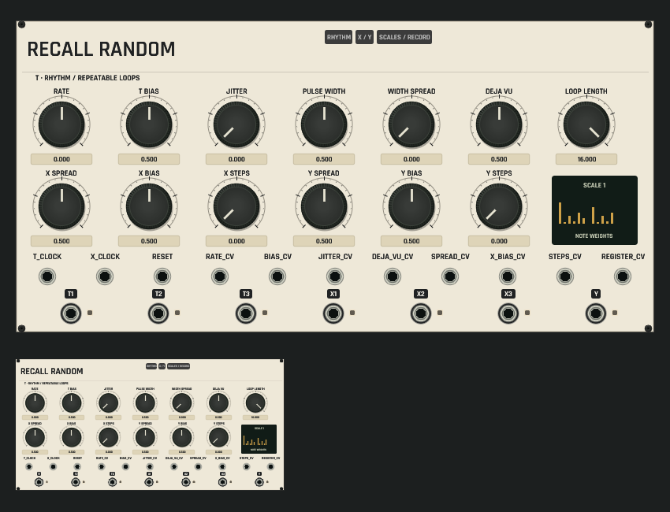
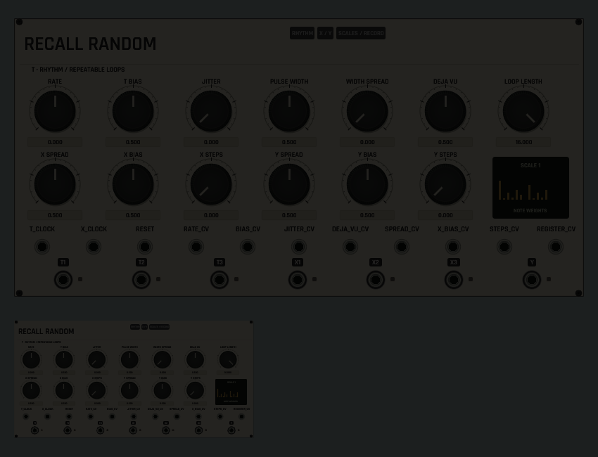

# Recall Random panel review

The actual shared rack/browser renderer, with thirteen large rotaries, scaled
RHYTHM / X-Y / SCALES dropdowns, saved weight display and eighteen patch ports.
The small view is the same renderer at library scale. These are headless
configured-state captures, not a native-window or audio-device qualification.

Focused geometry checks cover 25%, 50%, 100% and 140% scales. Real callback tests
cover the output lamps and recording/overflow state separately. Captures are
reviewed after focused production changes; full macOS CI remains the merge gate.
