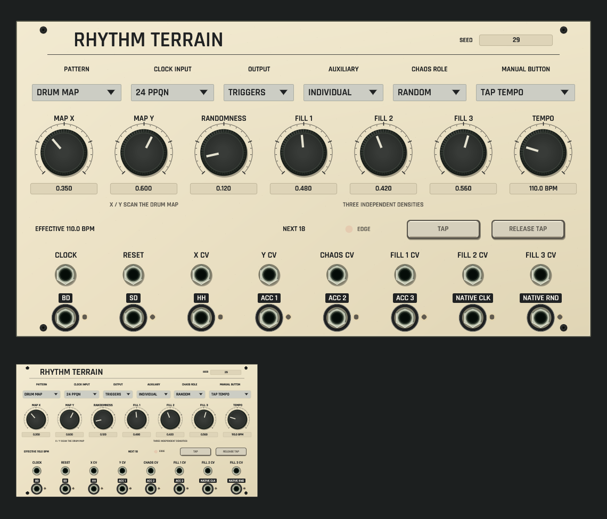

# Rhythm Terrain shared panel review

Development candidate, not installed. [Source and native contract](../../../docs/RHYTHM_TERRAIN.md).

CPU rendering of the actual rack/browser surface on macOS ARM, at full size and
42% thumbnail scale. Authored controls come from the
[soft-groove example](../../../examples/rhythm-terrain-soft-groove.json). Both
views use the same panel renderer, selected application font, seven large knobs,
six selectors, exact seed entry, sixteen ports and seated black screws. Map and
Euclidean modes relabel the actual controls and auxiliary outputs.

The isolated panel processes real offline Core state at 110 BPM. Effective BPM
and NEXT 18 are actual telemetry. No clock input is needed for this configured
internal clock. Trigger outputs happen to be low at the captured instant; lamps
remain dark instead of fabricating activity. Live callback tests separately
prove tap lock, pressed state and effective clock publication. Focused checks
cover all cable targets, native gestures/history, MCP anchors and five-scale
geometry. The exhaustive shared default-renderer guard covers all 91 development
catalog kinds.

[Dim-room view of the same state](dim-panel-and-thumbnail.png). Unlit controls
dim with the panel; no emissive wash is added. This opens no native window or
audio device.

Capture uses `export_panel_design_preview`, `OPENPATCH_PANEL_KINDS=rhythm_terrain`,
`OPENPATCH_PANEL_SCALE=1.5`, `OPENPATCH_PANEL_ENGINE_STATE=1`, and absolute paths
for `OPENPATCH_PANEL_PROJECT` and `OPENPATCH_PANEL_PREVIEW`. Dim capture sets
`OPENPATCH_PANEL_LIGHT=0.12`.
