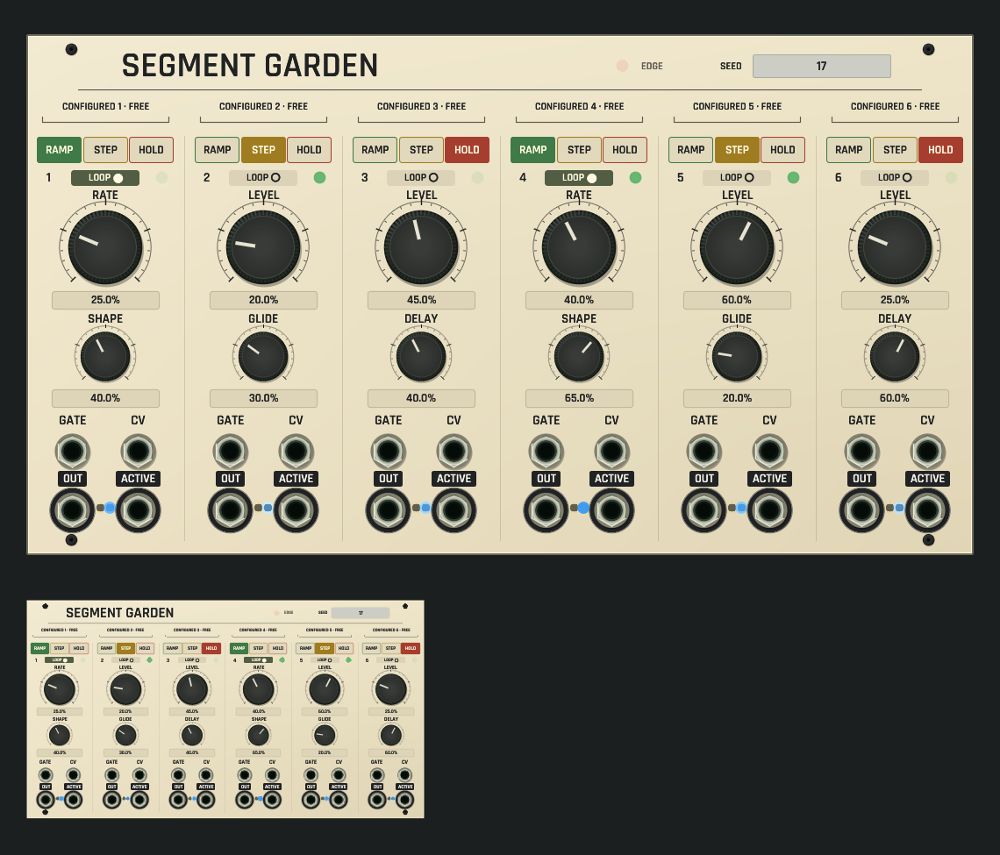

# Segment Garden shared panel review

Development candidate, not installed. [Source and native behavior contract](../../../docs/SEGMENT_GARDEN.md).

CPU rendering of the real shared rack/browser surface on macOS ARM. The authored controls come from the [three-instrument voice example](../../../examples/segment-garden-evolving-voice.json). The smaller panel uses the same renderer at 42% scale. The 48 HP face has six clear stage columns, large primary knobs, secondary knobs, source-meaningful type/loop choices, 24 enlarged sockets, selected application font and seated black fasteners. No separate thumbnail artwork is used.

This isolated-panel capture has no gate cables, so every stage is an independent function. Its CONFIGURED group guide describes that patch structure. The full example sends Garden output1 into Tidal Functions, which scans Frame Scene to shape a soft filtered voice. The knobs and type/loop choices show authored controls; output, activity and edge-limit lamps use actual offline Core publication after 60,000 frames. No trace, phase or glowing activity is fabricated. No native window or audio device is opened.

[Dim-room capture with the same real state](dim-panel-and-thumbnail.png). The local status lenses remain readable without a bright panel wash. Ramp/Step/Hold green/yellow/red identify real modes; contextual markings distinguish rate, time, level, glide, delay, chance, reset/direction and held-time behavior.

Focused UI checks cover geometry/text at five scales, physical grouping, contextual source labels, knob/selector gestures, real/absent telemetry, MCP anchors and Custom plus functional category membership. The complete default inventory guard draws all 89 kinds through the same shared rack/browser renderer. Native Engine golden traces, callback no-heap checks and actual stdio MCP history/preset/save/reopen workflows are separate evidence.

Capture uses `export_panel_design_preview` with `OPENPATCH_PANEL_KINDS=segment_garden`, `OPENPATCH_PANEL_PROJECT` pointing to the example, `OPENPATCH_PANEL_SCALE=1.5`, `OPENPATCH_PANEL_ENGINE_STATE=1` and an explicit output path. The dim capture adds `OPENPATCH_PANEL_LIGHT=0.12`.
