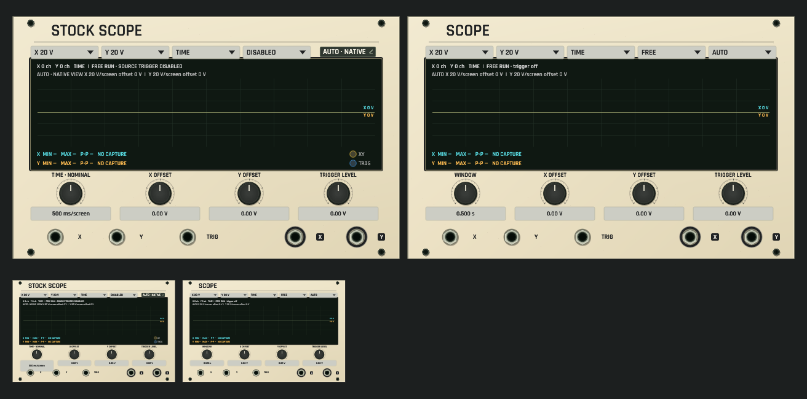
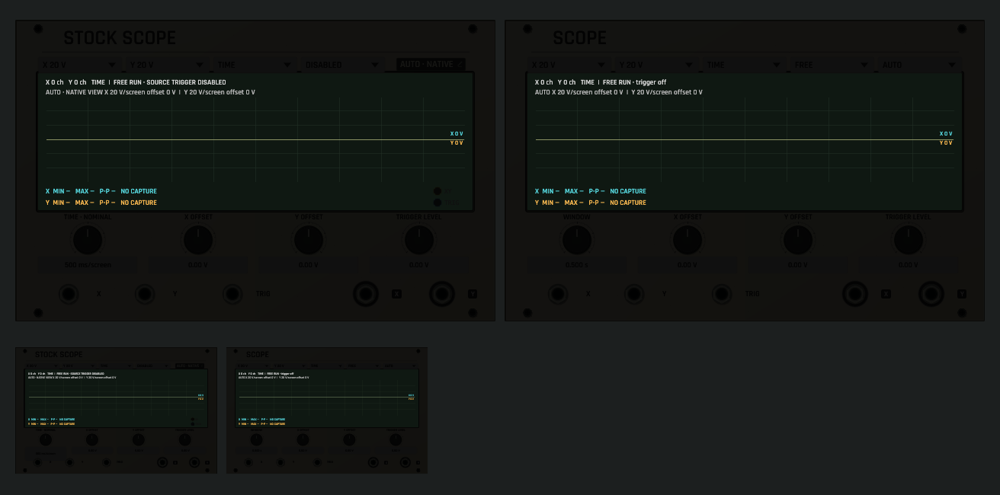

# Stock Scope application review

Stock Scope uses the shared Signal Atlas face alongside the existing Scope. Its eight source controls, independent X/Y passthrough ports and calibrated source view remain separate from native AUTO fitting. TIME displays nominal milliseconds per screen; the patch stores the source log2 inverse-seconds control.

These captures use the actual shared renderer and offline Core publication for disconnected default modules at full and overview sizes. They deliberately show zero input channels and no capture; they do not fabricate incoming audio. Browser thumbnails use the same rendering. The smaller, softer halos preserve readable lenses without broad neon spill.

Focused interaction tests separately exercise a real weak published signal, manual and automatic display ranges, successive TIME edits and undo, stale typed edits, reduced-zoom jack/control separation and source lamp behavior. Real callback tests cover publication into MCP inspection and module lifecycle without opening an audio device. See [Stock Scope qualification](../../../docs/STOCK_SCOPE.md) for the bounded numerical and application evidence.

No native-window, audio-device or installed-release qualification is claimed by these headless captures.
