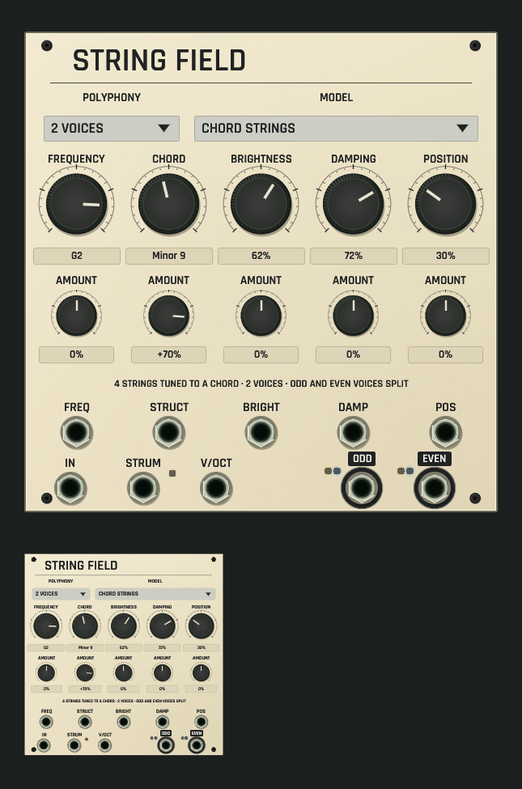

# String Field shared panel review

Development candidate, not installed. [Source and native contract](../../../docs/STRING_FIELD.md).

CPU rendering of the actual shared ModulePreview/rack surface on macOS ARM, at
full size and 42% thumbnail scale, using the selected application font. The
authored face is the chord-strings example (two voices, structure CV amount
+70%): two selectors (polyphony, model), five large rotaries (frequency,
structure, brightness, damping, position) and five AMOUNT attenuverters under
them, each with a plain-word caption and a readout in its own unit (a note
name for frequency, the chord name in the chord-strings model, percent, or
signed percent for the attenuverters). The guide line states the configured
model and voices. Five CV inputs sit under the controls they modulate; the
exciter, strum and V/OCT inputs and both outputs run along the bottom, clear of
the corner screws. The strum lamp beside the STRUM jack and the output lamps
are driven only by actual offline Core processing (60,000 frames); they stay
dark here because the single-module preview has nothing patched, and with
every input normalized the source never strums. No audio device or window is
opened.

Captions follow the model (sympathetic strings: INTERVALS; inharmonic string
and string with reverb: STIFFNESS; FM voice: RATIO, INDEX, DECAY, FEEDBACK;
chord strings: CHORD). Focused tests check print, rotary/value targets,
selectors and port rims at five scales, model- and polyphony-dependent
captions, readouts and guide text, revision-fenced drag edits sharing one undo
gesture, and measured output and strum lamps. The polyphony selector stores
the voice count (1–4) through the catalog value list.

[Dim-room capture with the same real lamp state](dim-panel-and-thumbnail.png).
Unlit controls and print dim with the room.

Capture: `export_panel_design_preview` with `OPENPATCH_PANEL_KINDS=string_field`,
`OPENPATCH_PANEL_SCALE=1.5`, `OPENPATCH_PANEL_ENGINE_STATE=1`,
`OPENPATCH_PANEL_PROJECT` set to the absolute path of
`examples/string-field-chord-strings.json` and an explicit
`OPENPATCH_PANEL_PREVIEW` path; dim capture adds `OPENPATCH_PANEL_LIGHT=0.12`.
