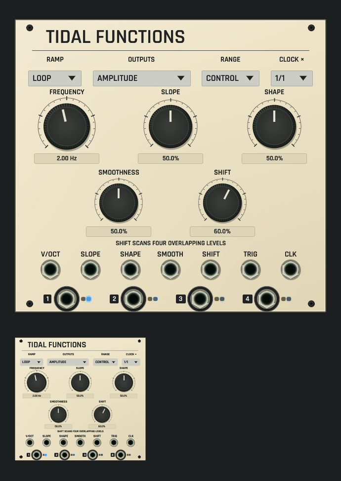

# Tidal Functions shared panel review

Development candidate, not installed. [Source and native behavior contract](../../../docs/TIDAL_FUNCTIONS.md).

CPU rendering of the actual shared ModulePreview/rack surface on macOS ARM, using the selected application font, five native rotary controls, four selectors, seven input sockets, four outputs, seated anodized fasteners and source-mode relationship print. The smaller panel uses the same renderer at 42% scale; it is not separate artwork. Output lamps come from actual offline Core processing (60,000 frames), with no audio device or native window opened. No live scope trace or physical-light accuracy is implied.

The geometry test checks print, rotary/value targets, selector targets and enlarged port rims at five scales; the interaction test checks revision-fenced parameter edits with a shared undo gesture. A separate lamp test changes actual published bipolar components and verifies darkness without telemetry. All 87 default catalog previews pass the shared rack/browser drawing guard.

[Dim-room capture with the same real offline lamp state](dim-panel-and-thumbnail.png). Local measured lamps remain visible while unlit controls and print dim with the room; no broad emissive panel wash is added.

Capture: existing `export_panel_design_preview` with `OPENPATCH_PANEL_KINDS=tidal_functions`, `OPENPATCH_PANEL_SCALE=1.5`, `OPENPATCH_PANEL_ENGINE_STATE=1` and an explicit `OPENPATCH_PANEL_PREVIEW` output path.
