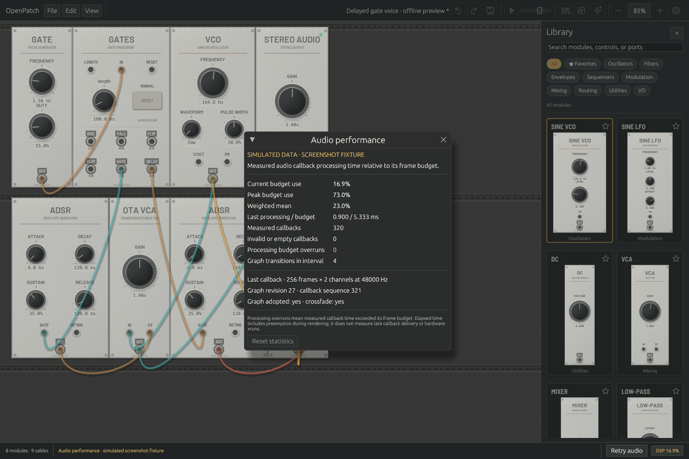

# Performance measurement

The goal is lower CPU use and predictable audio deadlines on large patches.
Rust alone is not evidence of a speedup. No VCV Rack comparison is available yet.

## Live callback diagnostics



*Native Linux / Mesa CI render using clearly labeled simulated data for layout
validation. These displayed numbers are not a live device measurement.*

Open **View → Audio performance**, or click **DSP** in the footer. The native
app shows current, peak and frame-weighted mean processing budget use, actual
buffer size/rate, interval callback counts and processing-budget overruns.
**Reset statistics** starts a new interval at the next callback; until then it
shows a pending reset. Reconnecting audio creates fresh statistics. Transport
pause still runs the callback and is measured.

Two monotonic clock reads measure elapsed wall time around graph adoption, state transfer, crossfade,
DSP, device sample conversion and existing telemetry publication. The timing
accumulator and its own atomic publication happen afterward and are excluded
from the reported duration. Preemption during processing is included; scheduling
lateness before callback entry is not. Storage is fixed; this adds no callback allocations,
locks, logging or per-sample clock reads. Readers make at most four attempts at
an independently coherent timing snapshot. Missing, closed or contended data
is shown as unavailable, never as zero budget use.

A callback's budget is its actual complete frames divided by the device sample
rate. A processing-budget overrun means elapsed nanoseconds × sample rate is
strictly greater than frames × 1,000,000,000, using integer arithmetic. This is
**not a hardware xrun counter**: it does not measure late delivery by the audio
driver or OS before callback entry. Zero-frame/channel callbacks have no utilization and do not
enter valid interval totals or peaks. Counters saturate rather than wrap.

MCP `inspect_performance.performance.audio_timing` exposes the same read-only
snapshot with its own completed-callback sequence, graph revision and reset
epoch. It is independent of module-state publication; consumers must not assume
those snapshots describe the same instant. See [the MCP contract](MCP.md).

For repeatable **headless callback** observations (no device is opened):

```sh
OPENPATCH_CALLBACK_PROFILE=/tmp/openpatch-callbacks.json \
  cargo test --release -p openpatch-desktop callback_timing_profile -- --ignored --nocapture
```

This harness covers one/sixteen functional oscillator, circuit-voice and full
Gates-history workloads at 48 kHz with 256-frame stereo buffers. It alternates
instrumented/uninstrumented timing order (comparing each batch's final buffer),
checks every warmup/steady/transition buffer for exact output equality, and
records graph checkpoint, cable edit and fresh-replacement adoption buffers.
Compilation is excluded. Timing results are observations, not CI pass/fail
thresholds or proof of hardware deadlines. The callback's 5 ms crossfade fits
inside each measured 256-frame adoption buffer. Cable edits can reduce the
active voice width. Initial Gates graphs and checkpoint transitions have full
histories; repeated fresh replacements start new histories.

### Headless callback observation — Apple M1 Max

A local release run of `058d3dd` on 2026-10-13 (Rust 1.99.0), before the
paired-circuit optimization below, produced these results.
Each buffer has **5.333 ms** of frame-time budget. Steady observations use 256
callbacks per workload; checkpoint transitions use 16 observations and include
state adoption plus both graphs during the crossfade.
[Raw timings, patches, source hashes and method](benchmarks/callback-timing-m1max.json).

| Workload | Steady median ms | Steady p99 ms | Checkpoint median ms | Steady overruns |
|---|---:|---:|---:|---:|
| Functional, 1 voice | 0.026 | 0.028 | 0.061 | 0/256 |
| Functional, 16 voices | 0.312 | 0.373 | 0.637 | 0/256 |
| Circuit, 1 voice | 0.597 | 0.663 | 1.205 | 0/256 |
| Circuit, 16 voices | 8.755 | 9.254 | 17.570 | 256/256 |
| Gates, 1 voice | 0.060 | 0.061 | 0.129 | 0/256 |
| Gates, 16 voices | 0.689 | 0.768 | 1.384 | 0/256 |

The sixteen-voice circuit patch exceeds this processing budget even without an
edit, and its checkpoint crossfade roughly doubles the cost. This makes circuit
processing and edit transitions the next optimization targets. These are
headless callback observations, not live audio-device distributions.

Five alternating enabled/raw batches per workload also measured the full
instrumented call, including statistics publication. Differences crossed zero
and varied with background activity (the one-voice functional median difference
was about 0.143 µs per callback). This run does **not** resolve a reliable precise
instrumentation overhead. Checked output buffers matched exactly. It establishes
neither faster-than-Rack performance nor glitch-free hardware playback.

## Paired circuit voices

The version-2 engine now processes independent ladder and OTA VCA voices in
pairs. Each FIR coefficient is shared across two independent accumulation
chains. Mono and odd final voices retain scalar processing. The equations,
f64 precision, tap order, separate multiply/add operations, eight circuit steps,
solver limits and 64-sample latency are unchanged. Each voice retains its own
history, parameters and diagnostics; persistent state size is unchanged.

On the M1 Max, the compiler generates paired **scalar** arithmetic, not SIMD.
The paired interpolation path still spills some accumulators to the stack, so
further improvement remains possible. New tests compare every sample and
internal solver state against independent scalar instances and frozen reference
code, including unequal histories/parameters, control-history draining, invalid
inputs, state adoption and voice shrink/regrowth. Public Engine tests cover odd
and even widths, CV normaling/broadcast/zero-padding, bypass and callback splits.
Existing response, alias rejection, latency and callback allocation tests remain
in place. These tests do not constitute commercial-hardware calibration.

A local Apple M1 Max / Rust 1.99.0 release comparison used five randomized,
interleaved pairs per workload at 48 kHz and 128-frame blocks. Each timed call
renders one audio second after warmup; compilation/RPC are excluded.
[Raw patches, timings, compiler details, binary and source hashes](benchmarks/paired-circuits-m1max.json).

| Workload | Before µs/frame | After µs/frame | Processing time reduction |
|---|---:|---:|---:|
| Ladder, one voice | 1.603 | 1.596 | 0.4% |
| Ladder, sixteen voices | 25.183 | 21.064 | 16.4% |
| OTA VCA, one voice | 0.724 | 0.732 | -1.1% |
| OTA VCA, sixteen voices | 10.898 | 6.736 | 38.2% |
| Full circuit voice, one voice | 2.319 | 2.294 | 1.1% |
| Full circuit voice, sixteen voices | 35.927 | 28.079 | 21.8% |

With audio-rate CV, sixteen-voice reductions were **14.4% for the ladder** and
**36.7% for the VCA**. Single-voice VCA median time increased by about 1.1%
(0.8% with audio-rate CV); those paired timing ranges crossed no change. The
single-voice full patch improved about 1.1%. These small changes should be read
alongside the raw ranges, not as universal speed guarantees. The sixteen-voice
full patch improved about **21.8%**, from approximately 0.580× to **0.742×
realtime**: it still runs slower than realtime on this machine.

All 50 paired benchmark checksums matched; all ten per-channel analyses matched
exactly and reported zero solver failures over their 0.5-second windows. This is
a comparison with the previous OpenPatch implementation, **not VCV Rack**.
Background activity, thermal state and lack of core affinity limit the result.

A separate headless callback profile of the final build recorded a sixteen-voice
circuit steady median of **6.885 ms**, versus **9.117 ms** in a fresh baseline
profile. Checkpoint medians were **13.718 ms** versus **18.286 ms**. Both builds
exceeded the 5.333 ms budget on all 256 steady circuit buffers. One-voice circuit
medians were 0.604 ms versus 0.575 ms; the functional and Gates workloads remained
well below budget at their medians. These are single sequential profiles per
build, so they do not isolate small regressions or establish a precise callback
speedup. The randomized offline comparison above provides stronger evidence of
the processing improvement.
[Complete callback observations and binary provenance](benchmarks/paired-circuit-callbacks-m1max.json).
Within each build, all checked instrumented/raw buffers matched exactly. This
comparison does not measure audio-device behavior or scheduling lateness.

## Offline engine throughput

Run release benchmarks using `cargo bench -p openpatch-core`, or MCP `benchmark`
on the current patch. The MCP result records sample rate, block size, node count,
OS/architecture, build mode, elapsed time, frames/s and realtime factor.
Compilation is excluded. Output is consumed to prevent the compiler discarding
the workload. A realtime factor of 20 means the offline run produced 20 seconds
of audio per wall-clock second; it does not guarantee live glitch-free playback.

The benchmark also measures the six-module reference voice, including the 8×
oversampled ladder and VCA. On an Apple M1 Max, Rust 1.99.0 release build at
48 kHz/128-frame blocks, a local 2026-10-12 run rendered 12.619 seconds in
2.000 seconds: **6.31× realtime**. This is one offline throughput observation,
not a live deadline test or VCV comparison. The simple legacy oscillator results
are not representative of the cost of these circuit models.

## Version-2 foundation measurements

Repeat the four included workloads with:

```sh
cargo build --locked --release -p openpatch
python3 scripts/benchmark_engines.py --seconds 1 --runs 3
```

A local Apple M1 Max / Rust 1.99.0 release run at 48 kHz and 128-frame blocks,
using three repetitions per workload, produced the following offline factors.
The script includes compilation-free processing of **all active voices**, even
though the mono output adapter selects one channel. The polyphonic voice uses
SUM before the audio interface. [Raw patches and results](benchmarks/engine-v2-m1max.json).

| Workload | Median × realtime | Observed range |
|---|---:|---:|
| Version 1 reference voice, one voice | 6.369 | 5.867–6.369 |
| Version 2 reference voice, one voice | 6.275 | 6.268–6.295 |
| Version 2 chord, three circuit voices | 2.113 | 2.095–2.116 |
| Version 2 chord, sixteen circuit voices | 0.390 | 0.387–0.391 |

The sixteen-voice oversampled circuit workload is **slower than realtime on this
machine**. Routing sixteen channels is supported; this measurement does not
promise that every sixteen-voice patch can play without underruns. SIMD and
circuit-processing optimization remain necessary. Keep these results distinct
from simpler polyphonic routing/utility workloads, callback deadline tests, and
any future VCV comparison. The version-1 and version-2 graphs also intentionally
have different cable timing, so these figures are diagnostic overhead/scaling
observations, not an identical-signal comparison or claimed speedup.

## Circuit implementation comparison

The `a9144a0` optimization preserves the circuit equations, coefficients,
8× oversampling, 64-sample latency per circuit module, and solver tolerances.
It removes repeated kernel copies, uses mirrored histories and independent
interpolation phase lanes, and reuses already evaluated Newton currents. Four
frozen-reference tests compare exact floating-point outputs, callback order,
solver state and diagnostics against the previous scalar implementation;
independent circuit-response and allocation tests remain in the suite.

On an Apple M1 Max, five randomized/interleaved pairs per workload at 48 kHz
and 128-frame blocks produced these **median offline processing times**. Each
call renders two audio seconds after warmup; compilation and RPC are excluded.
Both binaries were built with Rust 1.99.0 in release mode. See the
[full report](benchmarks/circuit-optimization-m1max.md) and
[patches, binary hashes and raw results](benchmarks/circuit-optimization-m1max.json).

| Workload | Before µs/frame | After µs/frame | Processing time reduction |
|---|---:|---:|---:|
| Ladder, one voice | 2.267 | 1.582 | 30.2% |
| Ladder, sixteen voices | 35.831 | 24.871 | 30.6% |
| OTA VCA, one voice | 1.083 | 0.701 | 35.2% |
| OTA VCA, sixteen voices | 16.919 | 10.833 | 36.0% |
| Full reference voice, one voice | 3.339 | 2.260 | 32.3% |
| Full reference voice, sixteen voices | 53.354 | 35.775 | 33.0% |

Audio-rate-CV cases reduced processing time by 29.1–29.7% for the ladder and
34.6–35.4% for the VCA. All 50 paired benchmark checksums matched; all ten
per-channel analyses matched exactly and observed zero solver failures during
their 0.5-second windows. These checks are evidence for the stated workloads,
not an exhaustive proof for every patch.

The full reference workloads achieved **9.22× realtime for one voice** and
**0.582× for sixteen**. The sixteen-voice case therefore remains slower than
realtime. These are approximately 1.48–1.49× throughput improvements over the
previous OpenPatch implementation, not over VCV Rack. Background system activity,
thermal state and lack of core affinity limit this single-machine comparison.

Mirrored storage adds **5,144 bytes per oversampler**. A compiled version-2 graph
with one ladder and one VCA preallocates 16 voices plus a template for each, so
its histories grow by **174,896 bytes (about 171 KiB)** even with one active voice.
Live state transfer copies these larger histories. Process RSS and callback-tail
cost during a live crossfade have not been measured.

Reproduce a paired comparison using two separately built release CLI binaries:

```sh
python3 scripts/compare_engines.py \
  --baseline /path/to/baseline/openpatch \
  --candidate target/release/openpatch \
  --baseline-source 98edb73 --candidate-source a9144a0 \
  --runs 5 --seconds 2 --output comparison.json
```

The standard-library script includes all ten patches, binary hashes and every
raw timing. It shuffles workload order and interleaves baseline/candidate calls,
checks benchmark checksums and per-channel analysis, and exits unsuccessfully
if the checked signals differ. It does not build either binary or infer source
identity: provide source IDs that match the binaries you built. These offline
measurements do not establish live device deadlines or a VCV Rack speedup.

## Fair comparison protocol

To include stacked-input routing workloads, run
`python3 scripts/benchmark_engines.py --stacked --seconds 1 --runs 3` after
building the release CLI. This adds fixed two-module graphs with 1, 16, and
1,024 cables at both one and sixteen voices, plus the stacked pitch example.
The fixed module count helps isolate routing cost. These remain offline
throughput measurements; they do not measure live callback deadlines or Rack.

- Same machine, audio rate, channel/voice count, oscillator/filter algorithms,
  modulation and feedback semantics, output quality, and active signal paths.
- Release builds, documented compiler and application versions, power mode,
  thread count, audio backend, and device buffer size.
- Separate headless DSP measurements from UI/GPU overhead and device latency.
- Warm up, repeat, report median and spread. Live tests additionally report p95,
  p99, worst callback duration, xruns and memory use.
- Keep benchmark patches, commands, raw results and audio correctness checks.
- Do not compare a simple OpenPatch sine with an oversampled or bandlimited
  Rack oscillator and label the difference an engine speedup.

CI timing is diagnostic: shared runners are noisy. No hard speed threshold or
speedup claim should be based on one CI run. Broader SIMD work, multicore
scheduling and feedback optimization remain future work.
