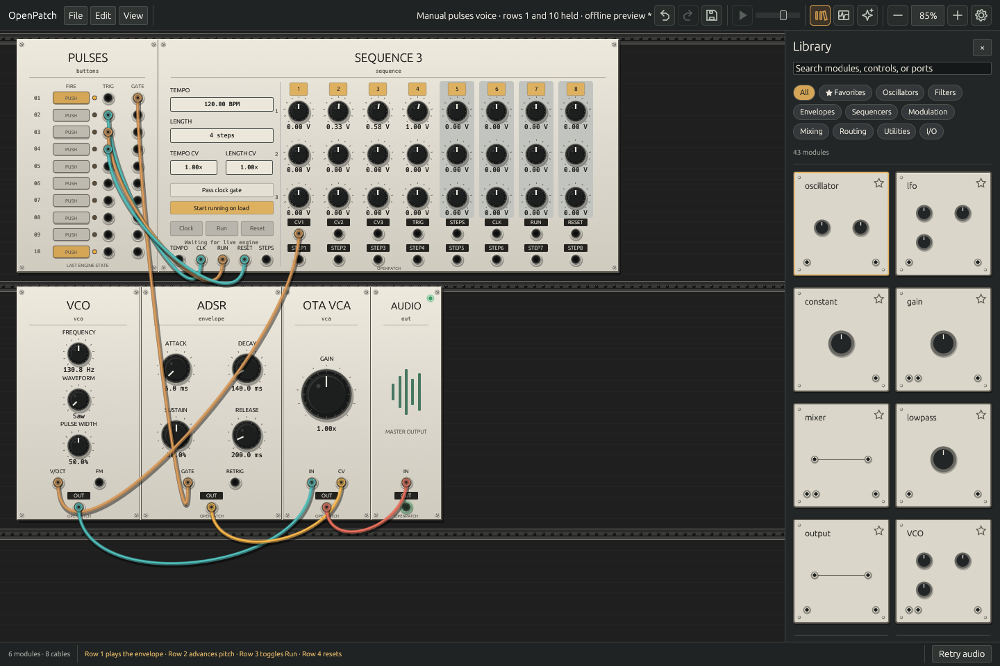

# Pulses: ten manual trigger and gate pairs

`pulses` is an original Rust implementation of the manual trigger/gate role described in the [VCV Free manual](https://vcvrack.com/Free#Pulses). It is a digital utility with ten independent buttons, no inputs or saved parameters, and twenty mono outputs: `trig1`…`trig10`, then `gate1`…`gate10`. It requires a version-2 patch.

*Native Linux CI capture using an offline engine snapshot, with rows 1 and 10 held. This is UI evidence, not macOS device playback qualification.*

## Play the connected example

Choose **File → Manual pulses voice**. Row 1 holds the envelope open; row 2 advances the four-note sequence; row 3 toggles sequencer Run; row 4 resets its position. The remaining rows are free for patching. Start audio to play the voice. The example is also available as [`manual-pulses-voice.json`](../examples/manual-pulses-voice.json).

The Studio Rack panel places one button and its TRIG/GATE jacks on each row. Button illumination follows that row’s actual held state. Releasing the pointer, leaving the button, losing focus, or opening a modal releases the locally held row. Fast clicks arriving within one UI frame enqueue both edges without leaving a held button. Live edges preserve order but may be consumed in different audio samples; offline same-frame events give exact sample placement.

## Timing and actions

Each gate is 10 V while its button is held and 0 V otherwise. A released-to-pressed transition starts a 10 V trigger lasting `ceil(sample_rate / 1000)` samples, including the transition sample: 45 at 44.1 kHz, 48 at 48 kHz, and 96 at 96 kHz. Repeated press actions while held create no new edge. Release leaves an existing trigger running; a subsequent press restarts its full duration.

Use `pulse1_press` / `pulse1_release` through `pulse10_press` / `pulse10_release` with live MCP `trigger_module`, or place them in sample-timed `module_events` for offline capture, analysis, or rendering. Actions are ordered and limited to 64 per module per sample. A same-sample press/release produces a trigger with no held gate; multiple rows can be held independently through MCP. Channel indices outside 1–10 and noncanonical action strings are rejected.

OpenPatch starts every row released and treats an action before the first sample as a deliberate edge. This and ordered same-sample clicks are explicit event-interface policies; they do not reproduce Rack’s uninitialized BooleanTrigger sampling semantics. Integer pulse lengths avoid accumulated floating-point timing drift. All version-2 cables add one sample of propagation delay.

## Safety, state, and inspection

Ordinary releases affect only the specified row. If the live event queue is full, a release uses the emergency path: it clears **all ten held buttons**, invalidates older queued actions, and preserves pulse countdowns. The same protection reaches both engines during a graph crossfade. A receipt reports acceptance; `inspect_performance` reports callback-applied state.

Compatible same-rate graph edits, movement checkpoints, and undo/redo retain held buttons and trigger countdowns. Preset application releases transient controls. Bypass clears held/pending controls, silences every output, and freezes remaining pulse time. Initialization, fresh compilation, project load, duplication, and sample-rate changes start fresh transient state. Patch and preset files never store pressed buttons, queued actions, or pulse remainders.

Live `controls.pressed_mask` uses bits 0–9 for rows 1–10; `controls.pressed` means any row is held. The ten light entries identify individual rows. Telemetry uses fixed-capacity storage and bounded coherent snapshot reads; rendering and graph adoption must remain allocation-free.

## Validation boundary

Tests cover pulse duration at three sample rates, all rows, repeated/retriggered and same-frame actions, invalid indices, queue saturation, bypass, initialization, preset history, remove/re-add, callback publication, MCP traces, and native pointer hit targets. Linux CI captures the native panel. These are OpenPatch contract tests; direct executable differential comparison with VCV and macOS device playback qualification remain open.

The behavioral reference is [Fundamental Pulses at revision 10dd016](https://github.com/VCVRack/Fundamental/blob/10dd0160c664770910e5584b7b00498cc48d9ddd/src/Pulses.cpp). OpenPatch does not include that GPL source or its panel artwork. The existing clock oscillator `gate` retains its own behavior. Push’s persistent HOLD latch and Gates’ delay/timing processor remain separate planned modules.
