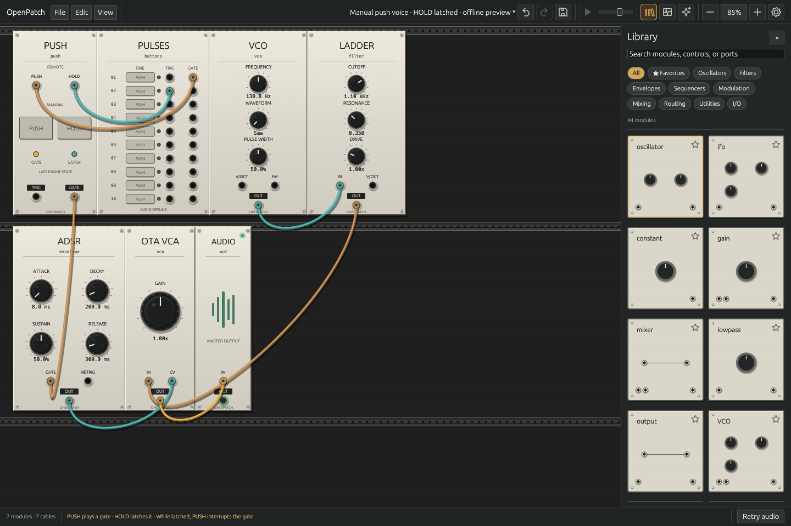

# Push: manual gates and persistent HOLD

`push` combines momentary manual/CV control with a saved HOLD latch. It is an original Rust digital utility based on the behavioral role of [VCV Push](https://vcvrack.com/Free#Push), with explicit timing and event policies. It is not a circuit model or a sample-identical port.

## Play the connected example

Choose **File → Manual push voice**. Hold PUSH to play the envelope. Click HOLD to latch the note; while latched, holding PUSH interrupts the gate and releasing it restores the note. The Pulses module offers remote control: row 1 drives PUSH CV and row 2 toggles HOLD CV. The connected patch is [`manual-push-voice.json`](../examples/manual-push-voice.json).

The native panel separates two physical buttons from the GATE and LATCH indicators. Button depression follows actual held controls; LATCH follows the audio engine’s current HOLD state. Releasing the pointer, leaving a button, losing focus, or opening a modal releases the physical control. A fast click delivered in one GUI frame still queues both edges.

*Native Linux/Mesa CI render with HOLD latched in an offline engine preview. This image does not demonstrate audio-device playback.*

## Signal contract

Inputs `push` and `hold` read channel 0 only, without polyphonic broadcast. Each detector switches high at 1 V and low at 0.1 V; the interval between thresholds retains its previous state. Nonfinite input is zero. An initially high input sets its detector without a rising-edge event.

Each HOLD-button press and HOLD-CV rising edge toggles the latch. PUSH combines the physical button and high PUSH CV with OR, then inverts that result while HOLD is enabled. `gate` is 10 V for the resulting true state and 0 V otherwise. `trig` emits 10 V on a final gate rising edge—including PUSH release while latched—for `ceil(sample_rate/1000)` samples. New gate rises restart that duration; releases do not truncate a pulse.

Current CV changes are folded into the first effective manual transition in a sample. A single HOLD press coincident with a HOLD-CV rise toggles twice without a ghost trigger. Multiple explicit actions at one sample then preserve their order, so a quick press/release can produce a trigger without a held gate. This ordered event extension, integer pulse lengths, immediate indicator brightness, and intentional first-sample manual transitions are OpenPatch policies. Loaded HOLD=true starts with a high gate and no startup trigger; an initially high PUSH CV also avoids a startup trigger. Ordinary cables add one sample of delay.

## Persistent and transient state

The validated parameter `holding` is 0 or 1, default 0. It represents the initial saved latch. Live HOLD can subsequently change independently. Native project Save/recovery, preset capture, and duplication capture **actual HOLD**, using the same coherent snapshot mechanism as SEQ-3 Run. `capture_project_patch` exposes additive `holding: {id: bool}` metadata beside the existing `running` map. Both kinds must report the requested revision and one common callback frame; unavailable state prevents an incorrect save.

Explicit `holding` assignments apply even if they equal the configured value. An omitted field in a partial preset preserves live HOLD; an explicit field assigns it. Shared undo/redo restores captured latch values. Initialize clears HOLD, while Randomize preserves it. Duplication captures the source’s actual latch into a fresh instance with no depressed buttons, queued actions, or pulse remainder. Changing sample rate starts from configured state.

Unrelated edits, module moves, and compatible graph adoption preserve the live latch, gate detectors and pulse history. Bypass releases physical controls and silences outputs while preserving HOLD and freezing pulse/detector processing. Emergency release clears both physical buttons and stale queued actions, preserving HOLD and pulse history. Assigning HOLD changes the next evaluated gate and can legitimately produce a trigger; it is not simulated by replaying a button action.

Project/preset capture is read-only. It observes a completed callback, not an audio freeze or acknowledgment of queued controls. Raw MCP `save_patch` retains configured graph values; use `capture_project_patch` when a client needs live persistent state.

## MCP and telemetry

Use `push_press`, `push_release`, `hold_press`, and `hold_release` with live `trigger_module` or offline sample-timed `module_events`. The fixed queue allows 64 actions per module per sample. Live click edges preserve order but can straddle audio samples. An overloaded release uses the existing module-wide safety path; a receipt reports acceptance, while `inspect_performance` reports callback-applied state.

Push reports `state.holding`, `controls.pressed_mask` (bit 0 PUSH, bit 1 HOLD), aggregate `controls.pressed`, and two light entries named `gate` and `hold`. Existing SEQ-3 state and `running` response fields remain unchanged.

## Validation boundary

Tests cover XOR combinations, thresholds, input channel selection, startup behavior, coincident CV/button edges, ordered clicks, pulse lengths at three rates, no callback allocations, bypass and state adoption, coherent mixed Run/HOLD snapshots, equal-value loads, preset omission, initialize/randomize, duplication, transaction rollback, remove/re-add identity, history, and native pointer controls. Native Save/recovery and dirty tracking include HOLD. Linux CI captures the native panel; direct VCV executable comparison and macOS device playback qualification remain open.

The pinned behavioral reference is [Fundamental Push at 10dd016](https://github.com/VCVRack/Fundamental/blob/10dd0160c664770910e5584b7b00498cc48d9ddd/src/Push.cpp). OpenPatch copies neither GPL implementation code nor panel artwork. Its `holding` parameter is a native representation of the reference’s custom `hold` state; full Rack patch import remains separate work.
