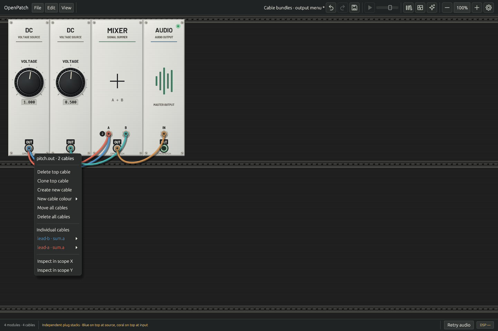
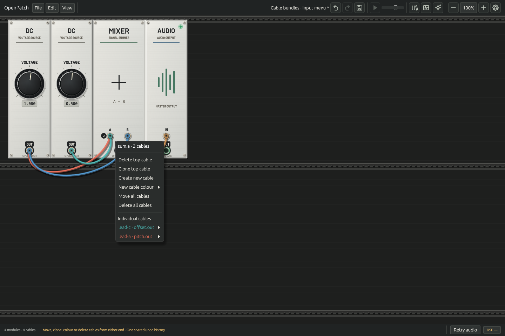
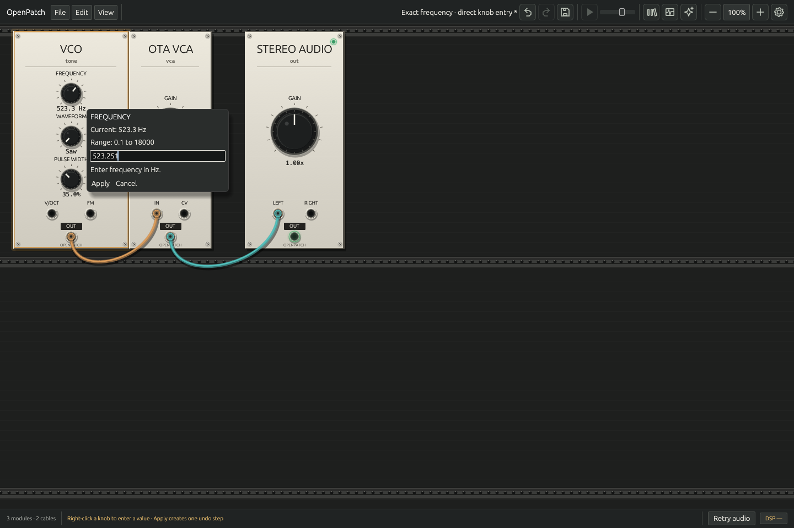

# Building and editing a rack

Use **Shift-click on module headers** to build a selection. A plain click on
an unselected module selects that module; dragging a selected header moves the
group while retaining its relative placement. **Cmd-A** selects the rack's
modules. Click empty rack space to clear selection. Keyboard shortcuts apply
outside text editors and dialogs; use Ctrl instead of Cmd on Windows/Linux.

The module context menu and keyboard offer:

| Action | Shortcut | Copied cables |
|---|---|---|
| Duplicate | Cmd-D | None |
| Duplicate selection with inputs | Shift-Cmd-D with a selection | Internal connections and incoming connections from outside the selection |
| Duplicate hovered module with cables | Shift-Cmd-D with no selection | All incoming and outgoing connections; self-patches become self-patches on the copy |
| Remove modules | Delete / Backspace | Removes the selection, or the hovered module when nothing is selected, with its incident cables |

Keyboard duplication gives any nonempty selection priority, including a single
selected module. With no selection, hover a module to duplicate it. The pointer
must be inside the rack; text editing, dialogs and active drags suppress these
shortcuts. Right-clicking an unselected module instead targets that module,
without replacing a selection elsewhere. Its menu offers **Duplicate with
cables**; a selected module's menu offers **Duplicate with inputs**.

Deletion uses unmodified **Delete** or **Backspace**. An existing selection
wins even when the pointer is over another module or outside the rack. With
nothing selected, the pointer must be over a module inside the rack. Holding
the key while moving the pointer uses the operating system's key-repeat events
to remove successive hovered modules. Text entry, dialogs, focus loss and active
editing gestures suppress deletion; locking module positions does not. Each
accepted deletion carries the displayed patch revision, so a newer MCP edit
cannot be silently overwritten. Undo restores modules, cable IDs/order and
committed placement.

Copies retain saved parameters, bypass flags and captured SEQ-3 Run state. Their
IDs are new; other running DSP state starts fresh. Existing modules retain their
live state. Group duplication leaves external destinations alone. Single-module
duplication with cables adds the copy's outputs to the existing destinations,
stacking them with the original connections. The selected audio output remains
unchanged. Legacy version-1 patches cannot stack inputs: the native single-module
with-cables action is unavailable when it would copy an external outgoing cable.
Incoming-only copies still work in version 1.

Copies are placed on free rack grid space to the right, preserving group
geometry. Group duplication selects the copies; single-module duplication
preserves the previous selection. The new copies are brought into view.
Placement and selection change
only after the revision-checked graph edit succeeds. A stale GUI snapshot or
invalid candidate leaves the current layout intact. Duplication and group
deletion are each one graph undo/redo action. Layout snapshots restore the
observed duplicated positions. Native projects save the resulting graph and placement.

Each completed single/group drag creates one revision-checked checkpoint in
that same history. Undo/redo follows the order of moves, parameter edits and
cable edits, including commands from MCP. Checkpoints preserve compatible DSP
state, selection and viewport. Drag previews are excluded from Save/recovery;
only accepted snapped positions become committed geometry. Escape, focus loss,
a modal dialog, a blocked/no-op drop, or a newer graph revision cancels the
preview without adding history. Pan/zoom remain persisted view settings without
separate undo entries.

While dragging a cable, nearby guidance names the route and the action the
current release will perform. It distinguishes creating or stacking a cable,
deleting a moved cable, and discarding a new or cloned draft. Press modifiers
keep their captured operation; changing Shift at drop updates duplicate-route
guidance. Unrelated routes soften during the gesture. **Esc** cancels. Guidance
uses the existing gesture rules and does not change the patch.

## Rack navigation

Zoom spans **25–400%**. Pinch or Cmd-scroll zooms around the pointer; mouse
buttons 4/5 zoom out/in at that point. **Cmd-minus** and **Cmd-equals/plus**
step between half-octave zoom levels around the rack's center. **Cmd-0** and a
double-click on the toolbar percentage restore 100% without resetting your
view location. Click the percentage once to enter an exact value. Use
**View → Reset rack view** to reset both zoom and pan.

Scroll or middle-drag to pan; Shift-scroll moves horizontally. Hold the arrow
keys to move the view continuously. Cmd slows movement to one quarter speed,
Shift accelerates it fourfold, and Cmd+Shift slows it to one sixteenth. Panning
uses elapsed time to stay consistent across display refresh rates. Text entry,
library keyboard focus, dialogs, and active editing gestures suppress rack
navigation. Use Ctrl in place of Cmd on Windows/Linux.

**View → Lock module positions** prevents single and selected-group mouse
moves. Turning it on cancels any unfinished move. Selection, knobs, cables,
module insertion, and undo/redo remain available. The lock is saved with host
preferences rather than inside a patch. Pan and zoom are saved in projects and
crash recovery without adding graph undo steps. View coordinates are bounded
to ±1,000,000 logical pixels, keeping every allowed module position reachable
at 400% and preventing navigation from producing an unsavable project.
At that outer bound, zoom anchoring yields to the view limit.

**View → Room brightness** adjusts rack illumination from 0 to 100%. **Darkroom**
sets 10%; **Lights on** restores 100%, the default. Panels, printed labels, controls,
cables, and rack rails dim together. Actual module lamps, meters, step indicators,
Scope screens, and connected top-plug signal lights keep emitting from the latest engine telemetry. A missing engine
publication stays unavailable; no display blink timer substitutes for a signal.
Small lamp halos increase as the room darkens. Cables still pass in front of lamps
and scope traces. Selection, menus, numeric editors, patching guidance, construction
cues, and host chrome keep their normal contrast. Browser previews use neutral 100%
lighting to help identify modules.

Plug signal lights show green/red for positive/negative mono signals and blue for
polyphonic signal energy. Each input shows its actual sum, so stacked signals can
cancel while their source plugs remain lit. Cable color and patching highlights
have separate meanings. See [signal lights](PORT_LIGHTS.md).

Room illumination is a host preference, saved as `room_brightness` in
`.host-settings.json` (a finite number from 0 to 1). It does not change a project,
its dirty state, recovery data, undo history, audio, or MCP graph state. Invalid or
missing values restore 100%; finite values are clamped to the supported range.

These interactions follow the [Rack key commands](https://vcvrack.com/manual/KeyCommands)
and [View menu](https://vcvrack.com/manual/MenuBar). Zoom stepping and modifier
ratios were checked against the pinned
[Rack viewport](https://github.com/VCVRack/Rack/blob/8ea470f343058ade6f75f16d503a1eb330e1700c/src/app/RackScrollWidget.cpp)
and [keyboard navigation](https://github.com/VCVRack/Rack/blob/8ea470f343058ade6f75f16d503a1eb330e1700c/src/app/Scene.cpp)
implementations. Arrow cadence is deliberately based on elapsed time, using
Rack's nominal 60 Hz movement as the baseline.

## Clear cables

**Edit → Clear cables** removes every cable in one undoable action, keeping
modules, parameters, output selection and module positions. It is disabled when
there are no cables. Undo restores the exact routing and cable IDs/order;
redo clears them again. Removed cable delay state starts fresh when a route is
restored, while the modules retain their running state. Native Save and recovery
preserve the resulting patch.

The same atomic operation is exposed as MCP `clear_cables`, including preview
and batch support. A direct call with no cables is a validated no-op: revision,
undo, redo and ongoing parameter-history grouping stay unchanged. See the
[MCP contract](MCP.md#atomic-edits-and-shared-history).

Deletion and clearing follow the [Rack key commands](https://vcvrack.com/manual/KeyCommands)
and [Edit menu](https://vcvrack.com/manual/MenuBar).

## Cable gestures

| Gesture | Result |
|---|---|
| Drag an empty jack | Start a new cable; connect to the opposite jack type. |
| Drag an occupied jack | Move its top plug to another jack of the same type, retaining the other endpoint and cable ID. |
| Cmd/Ctrl-drag from either jack | Start another cable, keeping the clicked jack fixed and every existing cable. |
| Cmd/Ctrl+Shift-drag an occupied jack | Clone the top cable and move its clicked end. The original stays; the clone receives a fresh ID and the same rendered RGB color. An empty jack starts a new cable. |
| Shift-click a jack | Delete its top cable immediately on press. An empty jack does nothing. |
| Drop a moved plug on empty space, the wrong jack type, or an existing identical route | Delete only the picked cable in one undo step. Fresh/clone drafts are discarded without changing originals. |
| Return a moved plug to its original jack | No change and no history entry. |

Press modifiers are latched, so releasing them before the drag threshold does
not change the operation. In version 2, a valid new connection to an occupied
input preserves its existing cables. Exact duplicate routes are rejected by
ordinary gestures. OpenPatch additionally allows them when **Shift is added
at drop** after starting without Shift. The Shift used to start a clone does
not enable duplicates. Menu pickups require an unmodified primary press.

**Esc**, focus loss, a modal interruption, loss of the pointer without an actual
release, and a newer patch revision cancel the gesture. Version-1 stacking or
feedback, cable-capacity limits, and failed transactions also preserve originals.
A real release outside the rack is an empty-space drop and deletes a moved cable.
The live graph stays unchanged during previews; a successful move, clone, or
deletion is one guarded undo action. Native Save, recovery, and MCP retain the
resulting cable IDs and explicit colors.

Click-to-connect remains an OpenPatch extension using the same endpoint rules;
Escape or an empty-rack click cancels its draft.

### Reach jacks beyond the current view

While holding a cable drag, move the pointer into the **48-pixel band inside a
visible rack edge** to pan toward jacks beyond the view. Movement increases
smoothly toward the edge; corners allow diagonal movement. This works for new
cables, moved plugs, clones and bundles. The edge band stays the same screen
size at every rack zoom, and narrows to fit a very small visible rack.

Keep the primary button held while panning. Releasing it, canceling the gesture,
or leaving the visible rack stops edge panning; an idle click-to-connect or menu
pickup does not move the view. A drop uses the jack position last shown on
screen. Camera movement changes no module positions or graph routing. A cable
drop still requires the ordinary guarded edit. Pan is saved as a view setting
and adds no graph undo step.

### Cable menus and bundles

Right-click either end for **Delete top cable**, **Clone top cable**, **Create
new cable**, and **New cable colour**. Each listed cable has Move, Clone, Delete,
palette colours, and **Custom RGB…** with an explicit **Apply colour** action.
Changing colour preserves cable IDs, routes, and delayed signal state. Choosing
its current rendered colour does nothing. Menu pickup items support dragging
from the item or clicking the item then selecting a jack. Output scope actions
remain available beneath the cable menu.

**Move all cables** picks up every cable attached to the clicked jack. Drop on
another jack of the same type to move the bundle; existing destination siblings
remain. Cables that would create duplicate routes are deleted, while other
members move. Winners follow saved cable order. Adding Shift at drop permits
identical routes in version 2. Empty-space or wrong-type drops delete the picked
bundle. Returning a picked non-top plug to its original jack brings that end to
the top without changing the route; returning an already-top plug does nothing.
**Delete all cables** removes only that port's bundle.

A bundle operation is one undo step, including mixed move/delete results. Undo
and redo restore exact IDs, endpoints, colours, and array order. Escape, focus
loss, newer revisions, and unsupported version-1 graph changes cancel the entire
proposal. Opening a menu captures its revision; a changed patch makes it stale,
so even a reused cable ID cannot silently retarget an old menu action.





*Native Linux CI captures; macOS is the primary design target.*

Each jack has an independent bottom-to-top plug order. Picking up a cable only
raises the clicked end; its other end keeps its place. Menus, plug colors,
ordinary pickup, cloning, and Shift-delete use that jack's order. Move-all keeps
the picked plugs' relative order at the destination; duplicate-route winners
still follow saved cable-array order, which also determines DSP accumulation.

Promotion remains provisional during pickup. A successful drop saves routing
and ordering together; returning a non-top plug to its origin creates one
metadata-only undo step. Canceling discards both. Undo/redo, save/reload, and
recovery restore exact endpoint ranks. This deliberately adds atomic cancellation
and exact ordering history to Rack's pickup behavior. Rack promotes on pickup
and does not store plug ranks in its cable history actions.

### Saved cable palettes

The toolbar **Cable** swatch shows the next colour. Open it to choose a colour,
switch between named palettes, or turn **Advance after each cable** on or off.
With the rack idle, **[** and **]** select the previous/next colour. These keys
leave text fields, the library, dialogs and active gestures alone.

**Edit palettes…** opens a draft editor. Copy, rename or delete a palette; edit
RGB values; add, remove or reorder colours. **Apply** saves the draft; **Cancel**
leaves the current settings intact. Up to 12 palettes with 1–16 colours each are
stored in host preferences. Presets start with Studio, Bright and Muted sets.

A new cable captures the chosen RGB when its gesture starts. The next choice
advances only after that connection succeeds, and only if the choice has not
changed meanwhile. Cancellation, a failed/stale connection, moving and cloning
never consume the next colour. An explicit **New cable colour** menu choice is
an override and also leaves that choice alone. Menu colour rows use the active
palette. Clones keep their original effective colour.

Palette settings do not change patch history, the document's dirty state or
existing routes. New palette-created routes save explicit RGB in projects,
recovery and MCP state. Older uncoloured routes retain their source/port-derived
appearance; editing a palette does not recolour them. Undoing a cable restores
the graph without rewinding the host's next-colour choice.

Physical native input qualification, including macOS pointer and keyboard
behavior, remains open separately from headless tests and Linux captures.


These gestures are independently implemented against the pinned
[Rack port interaction source](https://github.com/VCVRack/Rack/blob/8ea470f343058ade6f75f16d503a1eb330e1700c/src/app/PortWidget.cpp#L398).
Earlier OpenPatch builds replaced destination groups on ordinary drops and used
Shift-press on an input to start a stack. The Rack gestures above replace those
behaviors; use Cmd/Ctrl to start an additional cable.

## Parameter faders

Shared continuous and stepped numeric parameter controls use **vertical
faders**. Click a position or drag vertically to set the value. Hold **Ctrl/Cmd** while dragging for ten times
finer movement; add **Shift** for one hundred times finer movement. Module
panels with their own specialized controls keep their own presentation.

With a fader focused, **Up/Down** changes its position by 1% of its travel; a
stepped control moves one permitted step. **Shift** uses 10% travel,
**Ctrl/Cmd** uses 0.1%, and **Ctrl/Cmd+Shift** uses 0.01%. Values stay on the
control's allowed steps. **Home** and **End** select the lower and upper limits.
These keys adjust the focused control; they do not pan the rack.

**Double-click** resets a shared fader to its default as one undo action.
Changes during one drag coalesce into one shared undo step. Click the displayed
number or right-click the control for exact entry in its displayed units.

Five shared categorical controls use horizontal segments, with explicit
catalog `values` and `labels`:

| Module / parameter | Choices and saved values |
|---|---|
| Analog VCO / `waveform` | Saw = 0, Pulse = 1 |
| Crossfade / `law` | Linear = 0, Power = 1 |
| Stereo Audio / `dc_block` | Off = 0, On = 1 |
| Score / `running` | Off = 0, On = 1 |
| Drum Voice / `mode` | Kick = 0, Clap = 1, Hi-hat = 2 |

Click a segment to select that exact state. Clicking or double-clicking the
selected segment reaffirms it, without an edit or undo entry; dragging across
segments does not select a state. A changed selection is one shared undo action.
With the choice focused, **Left/Down** selects the previous state and
**Right/Up** the next, stopping at the ends. **Home/End** selects the first/last
state. **Space/Enter** reaffirms the current state without cycling or editing it.
These keys keep focus on the choice and do not pan the rack.

Right-clicking a choice opens its existing precise parameter menu without
selecting a state; clicking the separate value field still opens exact entry.
Categorical double-click behavior applies to these segments; numeric faders
retain their fine dragging, accumulated small movements and default reset.
Fader positions and selected segments show configured values and dim with room
lighting. They do not act as live lamps or meters. Browser panels use the same
renderer with display-only defaults.

## Exact parameter values

Right-click a fader, categorical choice or knob to type a value directly in its parameter menu. Click its
displayed value, or focus that value and press Space/Enter, to open an editor. **Enter** or **Apply** commits a valid
value as one shared undo action; **Escape** or **Cancel** discards the draft.
Clicking outside the parameter menu cancels it. Losing app focus or opening
a modal editor also discards the draft. The editor shows the control's units
and accepted range. Controls displayed in decibels accept
`-inf` for silence; stepped controls require a permitted step.
Type a number, expression, or note name: `220*2`, `A4`, `C#4`, or `C4v`.
The current value is selected when the editor opens, and **Result** previews the
evaluated value in the control's entry units. Typing does not change the patch
until Apply or Enter. See [expression syntax and compatibility](PARAMETER_EXPRESSIONS.md).

In a module with multiple exact-entry controls, **Tab** applies the valid draft
and moves to the next control; **Shift-Tab** moves backward. Navigation wraps
within that module and keeps each accepted entry as its own undo action.

An open draft belongs to the patch revision at which it was opened. If another
edit, including an MCP command, changes that revision, reopen the control before
applying a value. The command also checks that original revision when committing,
so a concurrent change cannot be overwritten between drawing and applying the
editor. Rejected drafts add no undo entry.



*Native Linux CI capture with a focused-editor fixture; playback is paused.*

## Shared MCP operation

`duplicate_modules` uses an explicit, nonempty source-to-destination mapping.
Source IDs and destination IDs must each be unique. Every source must exist,
and every destination must be a valid unused module ID.

```json
{
  "modules": [
    {"id": "vco", "new_id": "vco_copy"},
    {"id": "filter", "new_id": "filter_copy"}
  ],
  "cable_mode": "inputs",
  "expected_revision": 12
}
```

Use the revision returned by `inspect_patch`, rather than the example value.
`cable_mode` defaults to `none`; `internal` copies only connections with both
ends selected, and `inputs` also copies external incoming connections. `all`
copies every connection touching a mapped module, including external outgoing
connections. It remaps each selected endpoint and retains each external endpoint.
Each original cable produces at most one copy, so self-loops and internal edges
are not doubled. The multi-module `all` mode is an explicit MCP extension beyond
Rack's group shortcut. Named ports, repeated routes and source cable order are
preserved; copied cables receive fresh IDs and start with empty delay buffers.
Original cables retain their IDs and order.

The operation works in `preview_edits` and `apply_edits`. Later operations in
the same transaction can edit the copies. Validation covers the final graph,
including engine version, module/cable limits, and cycle restrictions. Failure
does not change the patch, revision, undo/redo history, or live identities.
The operation returns the usual session snapshot; the supplied mappings
already identify every new module. Headless MCP changes the graph only; native
selection and placement are presentation state.

## Initialize and Randomize

Right-click a module or selected group and choose **Initialize** or
**Randomize**. The corresponding shortcuts are **Cmd-I** and **Cmd-R**
(Ctrl on Windows/Linux). Hover an unselected module to target it, or a selected
module to target the group; over empty rack space the shortcuts use the current
selection. Each action is one undoable graph edit. The action
retains module IDs, cables and their order, bypass flags, audio output,
selection and panel positions.

Initialize restores eligible saved controls to their descriptor defaults.
It also runs the module's specific initialization hook after live state has
been adopted:

| Module | Runtime effect beyond saved controls |
|---|---|
| Four-output VCO | Keeps phase, sync direction, correction tails and square filter memory |
| Four-output LFO | Resets phase and clock acquisition/timing; preserves clock and reset edge detectors |
| SEQ-3 | Returns to step one; keeps live Run state, phase, pulses and trigger detectors |
| Sequential switches | Keeps selected position, detectors and declick history |
| Process | Keeps sample/hold and slew history |
| Other modules | Retains the existing state-adoption behavior for parameter edits |

Initialization releases held manual buttons and cancels older queued module
actions. It works while bypassed and even if saved controls already equal
their defaults. It does not recreate the module or retire its cables.
MIX6 retains its menu-based invert and average modes.
SEQ-3's saved `running` setting retains both its value and its presence, so
initializing a paused live sequence does not inadvertently start it.

Undo and redo restore saved controls and captured SEQ-3 Run state; they do not
replay the runtime hook or rewind unsaved DSP phase or step position. If Initialize is immediately undone before the audio
callback receives a graph, its pending runtime hook still runs once. A
per-incarnation generation prevents later graph edits and history traversal
from repeating it. No control lock or allocation is needed in the callback.

Randomize samples only eligible saved parameters. Discover each control's
`initialize` eligibility and `randomization` distribution in `catalog`.
Distributions are disabled, linear, log2, inclusive integer, or enum; numeric
bounds respect the patch sample rate. VCO/LFO FM and PWM attenuverters retain
their settings. SEQ-3 randomizes voltage rows and gate flags while preserving
tempo, length, their CV amounts, Run and passthrough. Saved menu settings also
retain their values: [MIX6 modes](https://github.com/VCVRack/Fundamental/blob/e0ade9a23a9b41124ea3f4ec9aa2cb0b98c2529e/src/Mixer.cpp), VCA MIX response modes, switch declick, FADE
law, Merge channel count, and [Rescale multiplier/reflection modes](https://github.com/VCVRack/Fundamental/blob/e0ade9a23a9b41124ea3f4ec9aa2cb0b98c2529e/src/Rescale.cpp). Randomize does not select
a random live sequencer/switch step. Restoring its history entry restores the
sampled controls without drawing new values.

Both tools support atomic preview and commit:

```json
{"tool":"initialize_modules","arguments":{"ids":["vco","seq"]}}
{"tool":"randomize_modules","arguments":{"ids":["vco","seq"],"seed":12345}}
```

Use those objects inside `preview_edits` or `apply_edits`; include the observed
`expected_revision` on the outer request. Direct tool calls accept that field
too. IDs must be unique, existing, and number 1–256. A randomization seed is a
required unsigned 32-bit integer. Given the same starting patch, module IDs,
catalog and seed, preview and apply produce the same values. Each module gets
`FNV-1a32(UTF-8 ID) XOR seed`; its eligible parameter names are sorted and
sampled using SplitMix64. Thus changing the order of selected IDs does not
change the result. The UI supplies a fresh seed for each invocation.

The parameter policies for OpenPatch-specific modules are explicit product
choices, not claims of identical random distributions to Rack. The [native module preset library](MODULE_PRESETS.md) captures complete settings
and current SEQ-3 Run state. Rack `.vcvm` import and factory templates remain
unfinished.

The reference for initialization/history behavior is Rack 2.6.4
([module actions](https://github.com/VCVRack/Rack/blob/8ea470f343058ade6f75f16d503a1eb330e1700c/src/app/ModuleWidget.cpp),
[base module](https://github.com/VCVRack/Rack/blob/8ea470f343058ade6f75f16d503a1eb330e1700c/src/engine/Module.cpp),
[history](https://github.com/VCVRack/Rack/blob/8ea470f343058ade6f75f16d503a1eb330e1700c/src/history.cpp))
and Fundamental 2.6.4's
[LFO](https://github.com/VCVRack/Fundamental/blob/e0ade9a23a9b41124ea3f4ec9aa2cb0b98c2529e/src/LFO.cpp),
[SEQ-3](https://github.com/VCVRack/Fundamental/blob/e0ade9a23a9b41124ea3f4ec9aa2cb0b98c2529e/src/SEQ3.cpp),
and [VCO](https://github.com/VCVRack/Fundamental/blob/e0ade9a23a9b41124ea3f4ec9aa2cb0b98c2529e/src/VCO.cpp).

## Live identity across coalesced edits

The host tracks an incarnation for every node, independently of its saved ID.
Removing and recreating an ID, changing its kind, or replacing the document
starts a new incarnation even if the audio callback skips intermediate graph
revisions. Compatible parameter/cable edits retain the incarnation.

At graph adoption, recreated nodes retain fresh compiled DSP state and empty
incident cable history. Unchanged nodes and edges continue normally. The
previous graph remains available for the existing short host crossfade.
Identity comparison and state adoption use bounded preallocated storage; no
control mutex, allocation, deallocation, or JSON operation runs in the callback.

## Rack parity boundary

The shortcut cable policies and selection priority follow pinned Rack 2.6.4.
OpenPatch places groups to their right rather than centering them around the
pointer, and resolves collisions using its existing rack-grid placement policy.
It preserves global source cable order rather than appending internal cables
before external inputs. Explicit cable colours are retained; uncoloured cables derive their appearance
from each fresh ID and can differ from the source cable. Full plug ordering, Rack preset conversion,
factory templates and complete project-layout history remain open.

References: [Rack group serialization and duplication](https://github.com/VCVRack/Rack/blob/8ea470f343058ade6f75f16d503a1eb330e1700c/src/app/RackWidget.cpp),
[hovered-module cloning](https://github.com/VCVRack/Rack/blob/8ea470f343058ade6f75f16d503a1eb330e1700c/src/app/ModuleWidget.cpp),
and [keyboard dispatch](https://github.com/VCVRack/Rack/blob/8ea470f343058ade6f75f16d503a1eb330e1700c/src/app/Scene.cpp).

## Docked module library

Click the library toolbar icon (or press Enter with the rack focused) to browse modules in the
resizable right sidebar. Search names, descriptions, tags, controls and ports;
filter by musical role or star favorites. Favorites are saved with host preferences.
The library stays open while you patch cables or edit the rack.

Click a module or use Up/Down and Enter in search to add it near the visible rack
center and reveal it. Drag a tile onto the rack to preview its snapped placement,
then release to add it without changing the view. Occupied module positions are
avoided. Dropping outside the rack, pressing Escape during a drag or losing window
focus cancels the add. Escape with library keyboard focus closes the sidebar.

An add is one undoable host transaction, including the new module's placement.
A conflicting concurrent MCP edit rejects the stale add without moving modules or
changing selection. Modules requiring the polyphonic engine offer the existing
upgrade confirmation before they can be added to a version-1 patch.
